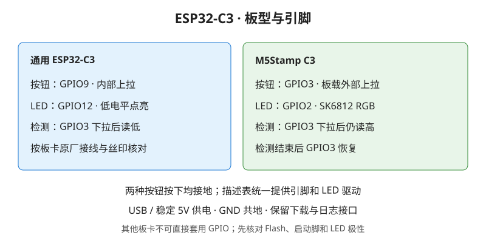

# BikePower C

运行在 ESP32-C3 上的蓝牙骑行与跑步模拟器，使用 C11、ESP-IDF v5.5.4 和 NimBLE。开机通过 BLE 工作，按钮二次确认后才开启临时 WiFi 配网。

[在线工具台与网页刷写](https://mengen-ink.github.io/bikepower-c/) · [快速上手](docs/user/01-quickstart.md) · [用户手册](docs/user/02-user-manual.md) · [文档索引](docs/INDEX.md)

Pages 手册分为设备按键与手机操作：手机机身内复用实际配置页，支持保存失败重试、功率计测试与跑步切换。可查看 [离线操作演示](design-demos/bikepower-ui/operation-demos/index.html) 与 [配网动画](design-demos/bikepower-ui/operation-demos/wifi.gif)；线上页面通过 GitHub Actions 发布，部署状态以最新工作流为准。

## 能力与版本

- 骑行：模拟功率、踏频、心率，支持固定模式、配速机器人及 FTMS ERG。
- 跑步：模拟速度、步频、心率与累计距离，支持 FTMS 开始、暂停、重置；骑行与跑步 GATT 表互斥。
- 真实功率桥接：最多保存三台 CPS 功率计，共享固定瓦数或比例校正；真实 0 W 保持 0 W。重启或断线后定向恢复，60 秒快速恢复失败后完整模拟输出，并每 60 秒轮转探测已保存设备。
- v4.4.0 三链路：最多两个下游客户端同时接收，同一快照分发；预留一个真实 CPS 上游连接。模拟 FTMS 只有一个控制者，真实桥接不提供 FTMS 或上游阻力控制。
- 设备配网：参数保存到 NVS，普通配网保持 BLE 在线，默认 300 秒，可信页面操作续期；后台轮询不续期。
- 电脑工具台：网页刷写、实时监控、设备比对、配置读写、健康检查与[设备状态](https://mengen-ink.github.io/bikepower-c/#/device-status)。含遥测的候选固件支持内存/CPU 百分比、RSSI 与独立详情窗口；手机可打开状态页面，蓝牙连接需浏览器支持 Web Bluetooth。

**网页刷写只提供正式 GitHub Release。** v4.4.0 已仅为通用 ESP32-C3 发布，M5Stamp C3 保留历史版本。完整设备矩阵、三链路/WiFi峰值、SC直接指示与其他系统兼容性未取得具体证据，不宣称Bluetooth完整认证。精确构建、验收和发行状态见 [PROGRESS](PROGRESS.md)。

## 硬件

| 板型 | 操作按钮 | 状态 LED |
|---|---|---|
| 通用 ESP32-C3 | GPIO9，按下为低电平 | GPIO12，低电平点亮 |
| M5Stamp C3 | GPIO3，外部上拉 | GPIO2，SK6812 RGB |

启动时用 GPIO3 输入下拉检测外部上拉，识别后恢复引脚。详细接线、供电与检测限制见 [硬件指南](docs/user/03-hardware.md)。



## 烧录与日常使用

1. 电脑 Chrome / Edge 打开[在线工具台](https://mengen-ink.github.io/bikepower-c/)，用数据 USB 线连接开发板。
2. 选择正确板型，核对正式版本、文件名与 SHA256，点击“连接串口并刷写”并主动选择串口。
3. 按安装弹窗提示完成，释放串口后复位或重新上电，在运动 App 中搜索 `BikePower`。

完整刷写流程与恢复方法见 [快速上手](docs/user/01-quickstart.md)。设备内 OTA 已移除，升级统一走电脑网页刷写。

默认按钮操作适用于模拟固定骑行模式：

| 操作 | 行为 |
|---|---|
| 短按 | 功率减小 20W |
| 按住超过 0.5s | 每 200ms 增加 20W |
| 按住满 2s 后松开 | 回滚本次临时调功，进入配网确认 |
| 在 3s 确认窗口内再按 | 开启 WiFi 配网 |
| 确认窗口内不操作 | 自动取消，保持 BLE 工作 |

配网时连接 `BikePower-XXXXXX`，密码 `12345678`；使用手机自动弹窗，或手动打开 `http://192.168.4.1`。点击“保存并应用”并等待成功回显，再点击“关闭 WiFi”并确认，或等待倒计时结束。关闭热点不提交未保存草稿；运动类型或广播服务改变时，App 可能需要重新配对。

默认 LED 慢闪表示广播、常亮表示已连接、快闪表示确认窗口；配网慢闪。M5Stamp C3 对应蓝/绿/黄/青色，自定义和静默配置以设备实际设置为准。详见 [用户手册](docs/user/02-user-manual.md)；手机离线阅读见 [离线手册](docs/user/pages-mobile-guide.html)。

## 开发与验证

无硬件优先验证使用[本地虚拟开发板](docs/dev/48-local-virtual-board.md)：Windows 原生构建 + 同机 WSL2 模拟器已跑通，macOS Apple Silicon 入口待实机验证。统一入口 `scripts/virtual_board.ps1` / `scripts/virtual_board.sh` 提供 setup、doctor、build、test 和 GDB debug；虚拟测试不替代真实射频、系统 GATT 缓存和发行门禁。

应用层位于 `main/`；纯 C 领域算法位于 `components/bikepower_domain/`，可在宿主机测试。BLE 配置、上游桥接与 RF 生命周期分别由专属模块维护。

| 目录 | 用途 |
|---|---|
| `main/web/` | 设备门户，构建时内联 |
| `tools/web/` | Pages 电脑工具台与手机手册 |
| `test/`、`tests/` | Host 单测、协议向量、静态门禁、浏览器与真机工具 |
| `scripts/` | 构建、烧录、串口守护与维护工具 |
| `docs/` | 使用说明、当前技术规范、Code Wiki 与历史归档 |

准备 ESP-IDF 环境后执行：

```bash
idf.py build
make -C test run
python3 scripts/tools/quality_gate.py --no-build
```

需要烧录时使用 `./scripts/flash_latest.sh`；双板构建使用 `./scripts/build_all.sh`。构建、真机证据和发布流程统一见 [构建与测试](docs/wiki/09-build-and-test.md)，分发固件必须是校验后的 merged bin。

日常增量构建可用 `python3 scripts/tools/dev_workflow.py build --mode production --board generic`；
切换 `--board m5stamp` 会使板型配置失效并重新构建。开发缓存记录源码、配置、
Git 和三个镜像的哈希；候选打包仍需校验这些身份，正式发行额外要求当前实物证据。

本地门户预览：

```bash
python3 tests/mock_server.py --bind 127.0.0.1 --port 8080
python3 scripts/tools/serve_ble_monitor.py
```

分别访问 `http://127.0.0.1:8080/` 和 `http://127.0.0.1:8766/`。Pages 预览不拉取发行固件，刷写入口显示不可用。

新版配置页先展示核心数值：新设备默认固定模拟功率、踏频与随动心率，其他模式、来源及广播兼容按需展开；已有配置正常恢复，展开不提交、收起保留草稿。月亮/太阳图标切换主题并记住选择，体重、FTP 和阈值心率固定在顶部。五项参数统一为目标与右侧 `±浮动` 同栏，下方滑杆调浮动；配速保留分钟与秒输入，非法值就近提示。机器人强度用分档滑杆，联动 W/kg、功率和 FTP 范围。可打开 [离线交互模拟](design-demos/bikepower-ui/configuration-preview/configuration.html)和[渐进配置与验证说明](docs/dev/62-portal-progressive-configuration.md)。重新生成使用 `python3 scripts/tools/export_configuration_demo.py`；专项入口为 `test_portal_theme_browser.cjs`、`test_portal_intensity_browser.cjs`、`test_portal_inputs_browser.cjs`（均在 `tests/` 下）。离线保存只修改演示数据，设备需安装包含新版页面的固件。

保存受非法输入阻止时，“定位错误”会展开并聚焦字段，保留已选运动与模式。“恢复已应用配置”撤销整页草稿并停止临时功率计测试，取消失败保留草稿；恢复不写设备配置。专项入口为 `node tests/test_portal_recovery_browser.cjs`，见[验证报告](docs/dev/64-portal-draft-recovery-validation.md)。

文档改动运行 `python3 scripts/tools/quality_gate.py --level docs`；源码事实由 `doc_facts.py --write` 更新，手机离线手册由 `sync_user_docs.py` 同步。协作规则见 [AGENTS](AGENTS.md)，当前实现见 [技术参考](docs/dev/01-technical-reference.md)，历史变化见 [CHANGELOG](CHANGELOG.md)。
