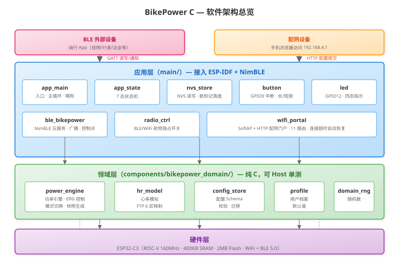
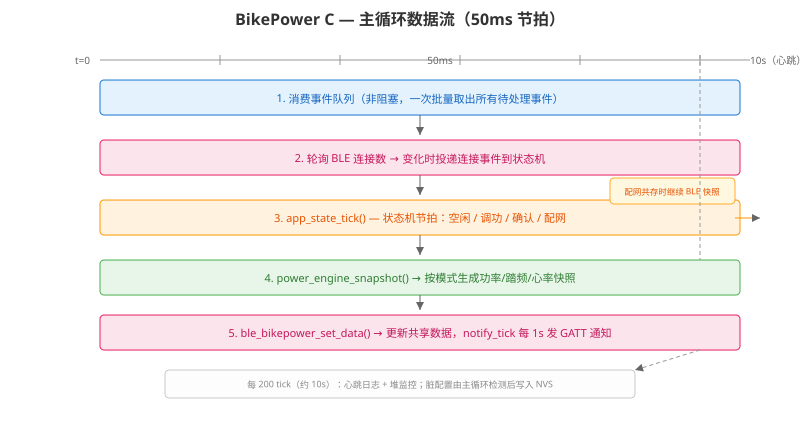

# BikePower C — 文档索引

项目文档概览，按读者群体划分。

---

## 🚴 普通用户 / 骑行爱好者

| 文档 | 说明 |
|------|------|
| [快速上手](01-quickstart.md) | 第一次使用 BikePower C 的全流程指南 |
| [README](../README.md) | 项目简介、功能清单、配图说明、引脚表、LED 灯效 |

## 🔧 开发者 / DIY 爱好者

| 文档 | 说明 |
|------|------|
| [硬件指南](03-hardware.md) | 推荐开发板、引脚定义、接线、供电、排障 |
| [重写方案](05-cidf-nimble-rewrite.md) | 从 MicroPython 到 C 的分阶段重写路线图 |
| [MicroPython vs C 对比](06-micropython-vs-c-comparison.md) | 两种技术栈的性能/内存/复杂度对比 |

## 🤖 AI 助手

| 文档/规则 | 说明 |
|----------|------|
| [AGENTS.md](../AGENTS.md) | AI 助手入口，必读优先级、硬性规则、验证要求 |
| [project-context.md](../.trae/memory/project-context.md) | 项目记忆（用户偏好、架构决策、踩坑记录） |
| [general-rules.md](../.trae/rules/general-rules.md) | 项目结构、模块边界、提交流程 |
| [coding-style.md](../.trae/rules/coding-style.md) | C/ESP-IDF 代码风格 |
| [hardware-constraints.md](../.trae/rules/hardware-constraints.md) | ESP32-C3 硬件约束 |
| [wifi-ble-mutex.md](../.trae/rules/wifi-ble-mutex.md) | WiFi/BLE 射频互斥规则 |

## 📊 配图

| 图片 | 说明 |
|------|------|
|  | 三层软件架构：应用层→领域层→硬件层 |
|  | 按钮操作、LED 四态、状态迁移 |
|  | 50ms 节拍的事件消费→BLE通知全流程 |

## 📋 进度与变更

| 文档 | 说明 |
|------|------|
| [项目进度](../PROGRESS.md) | 阶段 0-6 完成情况、待确认项、已知限制 |
| [更新日志](../CHANGELOG.md) | 版本历史与变更记录 |
