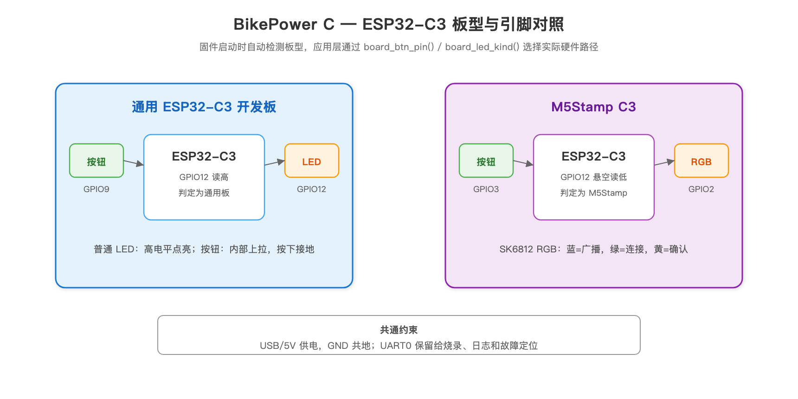
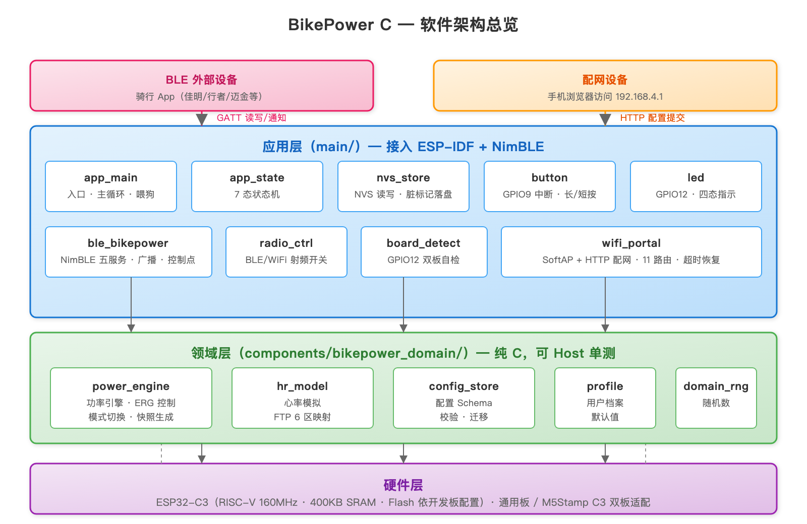
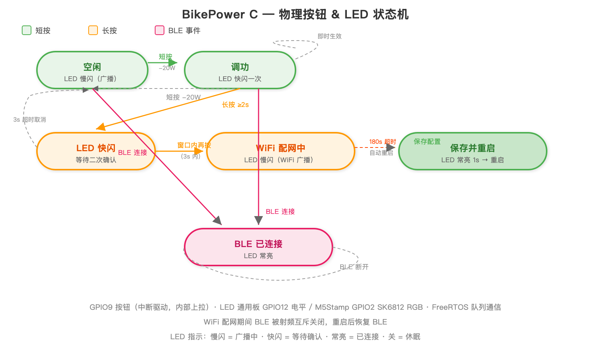
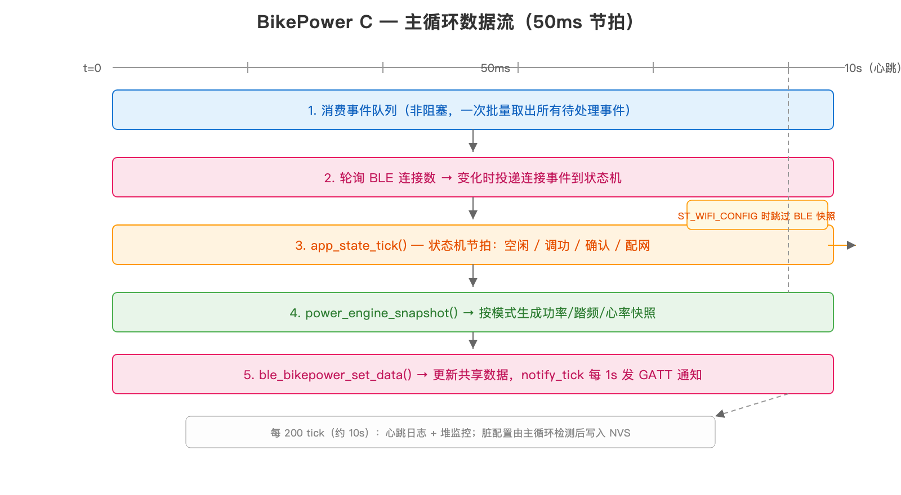
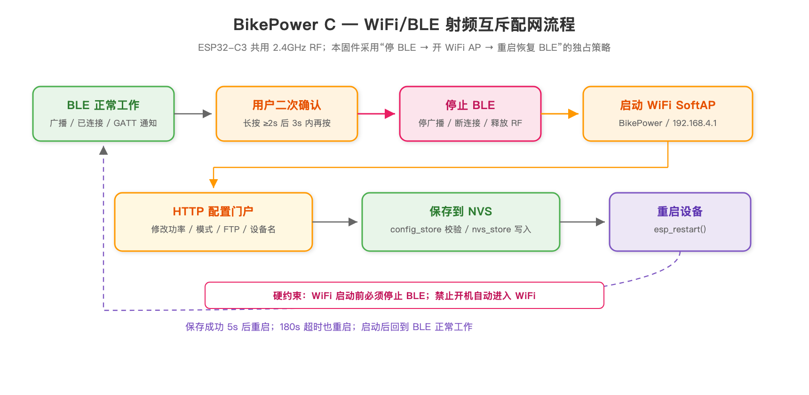

# BikePower C — 文档索引

项目文档按维度分目录管理：`user/` 产品使用、`dev/` 开发与技术、`archive/` 历史归档、`images/` 配图。

---

## 🚴 user/ — 产品使用说明

面向普通用户 / 骑行爱好者。

| 文档 | 说明 |
|------|------|
| [快速上手](user/01-quickstart.md) | 第一次使用：烧录固件 + 首次连接，其余细节链到手册 |
| [用户手册](user/02-user-manual.md) | 完整操作：按钮、LED、配网字段、骑行模式、FAQ、技术规格 |
| [硬件指南](user/03-hardware.md) | 推荐开发板、引脚定义、接线、供电、排障 |
| [README](../README.md) | 项目简介、功能清单、构建/门禁/Release 入口、配图说明、引脚表、LED 灯效 |

## 🔧 dev/ — 开发与技术

面向开发者 / 维护者 / 后续接手者。

| 文档 | 说明 |
|------|------|
| [技术参考](dev/01-technical-reference.md) | 三层架构、启动流程、BLE 服务、配网链路、配置 JSON、测试门禁（基于当前实现） |
| [固件防提取/防反编译](dev/02-firmware-security.md) | 编译层加固（已实现）+ Flash 加密/Secure Boot 方案与选型 |
| [测试覆盖率分析](dev/03-test-coverage-analysis.md) | 领域层/应用层模块清单、覆盖矩阵、目标 90% |

## 🗄️ archive/ — 历史 / 归档（仅供追溯）

以下文档对应历史版本或已完成的一次性工作，**不代表 v4.0.0 当前实现**，仅作背景追溯。

| 文档 | 说明 |
|------|------|
| [重写方案](archive/01-cidf-nimble-rewrite.md) | 从 MicroPython 到 C 的分阶段重写路线图（早期设计背景） |
| [MicroPython vs C 对比](archive/02-micropython-vs-c-comparison.md) | 两种技术栈的性能/内存/复杂度对比（选型阶段） |
| [优化审查清单](archive/03-review-checklist.md) | v3.1.0 多板型/发行流程/配网网页全链路复查（已完成） |
| [内存与新功能评估](archive/04-memory-and-feature-assessment.md) | v3.1.3 各场景内存实测、满负载分析、扩展可行性 |
| [v3.1.6 迭代规划](archive/06-roadmap-v316.md) | 在线 OTA + FTMS 扩展 + 内存优化规划（OTA 已于 v4.0.0 移除，仅供追溯） |
| [移除 OTA + 网页端精简方案](archive/07-remove-ota-plan.md) | v4.0.0 移除在线 OTA + 家庭网络、分区表改单 factory、网页端精简方案 |

## 🤖 AI 助手

| 文档/规则 | 说明 |
|----------|------|
| [AGENTS.md](../AGENTS.md) | AI 助手入口，必读优先级、硬性规则、验证要求 |
| [project-context.md](../.trae/memory/project-context.md) | 项目记忆（用户偏好、架构决策、踩坑记录） |
| [general-rules.md](../.trae/rules/general-rules.md) | 项目结构、模块边界、提交流程、文档命名规范 |
| [coding-style.md](../.trae/rules/coding-style.md) | C/ESP-IDF 代码风格 |
| [hardware-constraints.md](../.trae/rules/hardware-constraints.md) | ESP32-C3 硬件约束 |
| [wifi-ble-mutex.md](../.trae/rules/wifi-ble-mutex.md) | WiFi/BLE 射频共用规则 |

## 📊 images/ — 配图

| 图片 | 说明 |
|------|------|
|  | 通用 ESP32-C3 与 M5Stamp C3 的按钮、LED、板型检测差异 |
|  | 三层软件架构：应用层→领域层→硬件层（双板适配） |
|  | 按钮操作、LED 四态、状态迁移 |
|  | 50ms 节拍的事件消费→BLE通知全流程 |
|  | 二次确认进入配网：BLE 保持在线→启 WiFi→保存/超时→关闭 WiFi 回 BLE |

## 📋 进度与变更

| 文档 | 说明 |
|------|------|
| [项目进度](../PROGRESS.md) | 阶段 0-13 完成情况、第七轮 P0 真机验收清单、待确认项、已知限制 |
| [更新日志](../CHANGELOG.md) | 版本历史与变更记录 |
