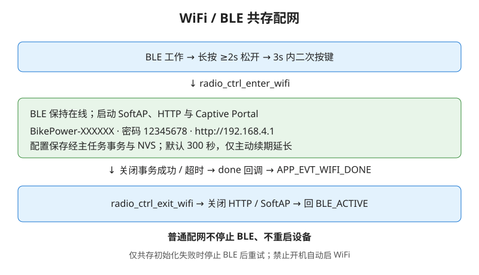

# BikePower C 技术参考

本文面向开发者、维护者和后续接手者。
内容基于当前仓库实现撰写，重点对应 `main/`、`components/bikepower_domain/`、`tests/` 和 `docs/images/`。
阅读顺序建议配合 [架构](../images/architecture.svg)、[主循环](../images/main-loop-flow.svg)、[按钮状态](../images/button-led-state.svg) 和 [WiFi 共存](../images/rf-wifi-flow.svg) 一起看。

当前固件版本为 `v4.4.0`。
运行环境为 `ESP-IDF v5.5.4 + NimBLE + FreeRTOS`，目标芯片为 `ESP32-C3`。

当前源码另提供独立只读遥测服务 `7a5a1000`：每秒统一发布内存、CPU 窗口、连接参数和发送计数，四组记录均不超过 20 字节。主任务采样，RSSI 由 NimBLE host 缓存；GATT 不同步查询 HCI。CPU 使用 FreeRTOS esp_timer 运行统计，Pages 状态页与常驻指标/窗口共用既有连接。详细布局、百分比口径和实物边界见 [设备遥测协议](36-device-telemetry-verification.md)。此功能尚未发布正式固件。

## BLE持久绑定安全策略（4.3.3）

NimBLE启用最多4个绑定记录，标准独立`nimble_bond` namespace存储安全密钥/CCCD/客户端能力；用户配置namespace与schema不变。使用SC Just Works、ENC/ID分发和public本机广播，保持FTMS骑行/跑步WRITE_ENC。容量满拒绝新增，不使用轮转删除；已有绑定重复配对不自动替换。启动逐记录核验实际NVS格式及RAM恢复，写入后补同身份更新落盘和回读，失败阻止密钥恢复及FTMS控制，不擦除记录。服务表可因配置变化重建，重新同步时通过Service Changed告知已绑定客户端。该早期候选五轮加密控制/四路300秒通知、已绑定时八组配置/GATT重建/重启与原配置恢复通过，但最终4ecf069镜像实物第二轮重连失败，正式发行阻断；持久CCCD存在跨服务表句柄失配线索，尚未修复。当前容量和存储故障仅host专项，未做多客户端满容量或真机写失败注入。若系统单侧忘记绑定，板端会拒绝覆盖；当前没有用户清绑定入口，需定向维护。最终发行门禁以PROGRESS.md为准；旧[会话修复报告](46-qidou-session-security-fix.md)仅记录先前无绑定手机验收，不代表当前候选通过。

## 未提交的订阅布局缓存候选（仍阻断发行）

新增 `ble_bond_cache` 按GATT注册布局SHA256区分旧订阅，独立namespace `ble_gatt_cache`、key `layout_sha`。布局变化先清旧CCCD，保留已有Service Changed订阅并置value_changed，核验NVS后才提交/回读布局；相同布局及同Host重复sync不重复清理。密钥和用户配置不清，失败阻止广播。当前caf973be候选真实普通复连与重启配置保持通过，但服务表重建后WinRT发现仍失败，不能作为已修复规格或正式固件。采集时CCCD为0，不证明重建前状态或唯一根因；原八组/DIS已独立恢复。完整结果见 [绑定发行核验](47-bonding-release-verification.md)。标准Database Hash/Robust Caching尚未启用。

## BLE外设连接状态确认

当前本地候选将CONNECT状态0或已观察到的远端特征错误26经`ble_gap_conn_find`确认，只有Host仍存在真实外设连接才发布应用句柄；开启SUBSCRIBE早于CONNECT确认时走相同验证。同句柄重复确认不重置订阅/控制，异句柄断开不清空当前连接，通知仍要求正确应用句柄和逐特征订阅。候选实物结果与未执行项见 [BINAVI连接修复](44-binavi-connection-fix.md)，不以构建通过代替码表验收。

已接纳下游首次建链时，以 peer identity 查询已有安全记录；安全存储正常、
LTK 存在且密钥长度合法、连接未加密时，主动请求恢复加密。EALREADY 表示
已有安全过程，不当作失败。未知客户端仍通过加密特征触发原配对流程，
不自动删除绑定，也不放宽 FTMS 的 WRITE_ENC。

## Pages 骑行端适配排查

Pages设备比对默认逐台只读采集第三方正常设备和开发板，两份GATT信息分别保存到本浏览器，支持单侧报告导入导出与刷新恢复；可尝试双连接，但不保证主机和设备能力。差异覆盖双向服务/特征、属性、能力位、读取值、通知帧结构与频率，未授权和采集失败不判缺失。旧身份模板功能保留为折叠工具，不等于补齐协议。实现、限额、验证和实物边界见 [骑行适配采集](42-cycling-compatibility-capture.md)。移动端删除重复二级教程，以项目介绍、主设备/手机操作演示和使用场景为主；主配网演示说明长按松开后二次确认开启设备WiFi热点，手机连接后进入配置页。

## 第一章：项目架构

项目整体采用三层结构。
这不是文档上的概念拆分，而是代码目录和职责边界的直接映射。

### 1.1 应用层：`main/`

应用层负责把用户输入、BLE 通信、WiFi 配网、LED 提示和主循环拼成一个完整设备。
关键文件如下：

- `app_main.c`：启动入口、事件循环、50ms 节拍、WDT、NVS 装载
- `app_state.c`：高层状态机，消费 `app_evt_t`
- `board_detect.c`：启动时检测通用 ESP32-C3 / M5Stamp C3
- `button.c`：中断驱动按钮任务，通用板 `GPIO9`，M5Stamp C3 `GPIO3`
- `led.c`：独立灯效任务，通用板 `GPIO12` 普通 LED，M5Stamp C3 `GPIO2` SK6812 RGB
- `ble_bikepower.c`：NimBLE 运动服务、生命周期、通知打包与 FTMS 控制点
- `ble_config_service.c`：八组配置 GATT、staging/revision、提交结果和断连取消；应用 API 仍由 `ble_bikepower` 包装
- `bridge_runtime.c`：协调三设备主备状态机、单设备会话、手动扫描和最近成功提示
- `ble_power_bridge.c`：单台已知 CPS 设备的定向连接、订阅、DIS 与样本快照
- `radio_ctrl.c`：WiFi/BLE 射频共用唯一入口
- `wifi_portal.c`：`esp_http_server` 配网页面（SoftAP 由 `radio_ctrl.c` 启动）
- `nvs_store.c`：旧 NVS 键迁移与领域层配置对象桥接
- `persistent_store.c`：完整配置/DIS 双槽快照、回读校验与提交标记
- `bikepower_config.h`：应用层常量中心

应用层的特点是“状态协调”而不是“算法本体”。
例如功率如何生成不在应用层决定，但什么时候生成、生成后发给谁、什么时候持久化、什么时候切 WiFi，都由应用层负责。

### 1.2 领域层：`components/bikepower_domain/`

领域层是纯 C 组件，可做 host 单测。
它不依赖 ESP-IDF，也不直接关心 BLE、WiFi、GPIO。

关键文件如下：

- `power_engine.c`：功率、踏频、心率快照生成
- `hr_model.c`：心率分区、平滑、HRV、对外限速
- `profile.c`：体重、FTP、阈值心率、配速机器人
- `config_store.c`：配置 schema、默认值、校验、迁移
- `json_miniparse.c`：轻量 JSON 字段提取
- `button_logic.c`：按钮按压语义纯逻辑
- `button_debounce.c`：去抖与长按节拍纯逻辑
- `led_pattern.c`：LED 模式、颜色与闪烁节拍映射
- `domain_rng.c`：领域层随机数
- `include/domain_config.h`：领域层常量中心

这层的价值是把“骑行模拟逻辑”和“设备运行逻辑”分开。
因此很多维护工作都可以先在 host 单测里完成，再接回嵌入式环境。

### 1.3 硬件与平台层

这里没有单独的 `hal/` 目录，但底层依赖很明确：

- FreeRTOS：任务、队列、信号量、调度
- NimBLE：BLE peripheral、GATT、GAP
- ESP WiFi：SoftAP
- NVS：配置持久化
- GPIO：按钮和 LED
- `esp_timer`：毫秒/微秒计时与定时回调
- Task WDT：主循环和长任务保护

对应关系可直接对照 [架构图](../images/architecture.svg)。
如果后续要重构，建议维持“三层职责不交叉”的基本形状。

## 第二章：启动流程

### 2.1 从 bootloader 到 `app_main`

标准 ESP-IDF 启动完成后进入 `app_main()`。
当前入口位于 `main/app_main.c`。

`app_main()` 的实际初始化顺序如下：

1. `ESP_LOGI(TAG, "BikePower C 启动...")`
2. `nvs_flash_init()`
3. NVS 初始化失败时不擦除分区；保留介质，进入只读默认配置，跳过快照及最近上游加载，BLE 可继续启动
4. `power_engine_init(&s_engine)`
5. `nvs_store_load(&s_engine)`
6. `power_engine_clear_dirty(&s_engine)`
7. `xQueueCreate(16, sizeof(app_evt_t))` 创建 `s_app_queue`
8. `led_init()`
9. `app_state_init(&s_engine)`
10. `app_state_set_wifi_trigger(on_wifi_trigger)`
11. `button_init(s_app_queue)`
12. `ble_bikepower_set_erg_callback(on_erg_target)`
13. `ble_bikepower_set_device_name(s_engine.device_name)`
14. `ble_bikepower_start()`
15. `domain_rng_seed(esp_random())` 用硬件随机数播种骑行模型
16. `esp_task_wdt_add(NULL)`
17. 进入永久主循环

这里有几个实现上的关键点：

- BLE 设备名并不是固定宏，而是先从 NVS 读配置后再调用 `ble_bikepower_set_device_name()`
- 领域层 RNG 保持纯 C、可在 host 固定种子复现；真机则在进入主循环前用 `esp_random()` 播种，避免每次上电重复相同轨迹
- 状态机先启动，再注册 `wifi_trigger`
- `button.c` 只拿到事件队列句柄，不直接依赖状态机
- `on_erg_target()` 不直接改领域层，而是先把 `APP_EVT_ERG_TARGET` 投递进队列

### 2.2 NVS 初始化与回退逻辑

配置加载通过 `nvs_store_load()` 完成。
当 namespace `bikepower` 不存在时，逻辑是：

1. `config_store_defaults(&c)`
2. `config_store_apply_to_engine(&c, e)`
3. `nvs_store_save(e)` 回写默认值

如果存在旧值，则：

1. 从键 `sv`、`power`、`cadence`、`mode`、`hr`、`hashr`、`pfloat`、`cfloat`、`hrfloat`、`pstep`、`weight`、`ftp`、`thr_hr`、`ride`、`cwkglo`、`cwkghi`、`cname`、`sport`、`bmask`、`rspeed`、`rpacef`、`rcad`、`rcadf`、`rmode`、`rpacer`、`rplo`、`rphi`、`rcname`、`devname` 和 `led*` 场景配置读取
2. `config_store_migrate(&c)`
3. `config_store_validate(&c)`
4. `config_store_apply_to_engine(&c, e)`
5. 若发生 migration 或 clamp，再保存一次修正后结果

因此启动时即完成：

- 默认值注入
- schema 版本处理
- 越界参数夹紧
- 名称字符串兜底

## 第三章：主循环数据流

主循环位于 `app_main.c` 的 `while (1)`。
节拍由 `HR_LOOP_INTERVAL_MS` 控制，当前值在 `domain_config.h` 中为 `50ms`。

### 3.1 每个 50ms 周期的顺序

每拍的执行顺序可以概括为：

1. 非阻塞 drain `s_app_queue`
2. 消费 WiFi 完成与 ERG pending latch，避免事件队列满时丢失关键状态
3. 若 BLE 未就绪则执行受控重试；仅共存失败的独占兜底暂停 BLE 时跳过快照
4. 调用 `ble_bikepower_conn_count()` 轮询连接变化
5. 如连接状态有变化，构造 `APP_EVT_CONN_CHANGED`
6. 调用 `app_state_tick()`
7. 调用 `power_engine_snapshot(&s_engine)` 或跑步快照路径
8. 调用 `ble_bikepower_set_data()` / `ble_bikepower_set_running_data()`
9. 每 200 拍打印一次心跳并检查堆内存
10. 如 `power_engine_is_dirty()` 为真，则调用 `nvs_store_save()`
11. `esp_task_wdt_reset()`
12. `vTaskDelay(50ms)`

普通 `ST_WIFI_CONFIG` 共存模式不会跳过快照：BLE 保持在线，主循环继续更新共享数据，通知定时器照常每秒发送。只有 `radio_ctrl_ble_suspended()` 明确表示共存启动失败并进入独占兜底时，才暂时跳过 BLE 数据路径。

这意味着主循环不是“所有 BLE 发包都在这里做”，而是“这里生成领域快照，BLE 定时器异步取走并通知”。

### 3.2 事件队列消费

队列元素类型为 `app_evt_t`。
当前事件种类在 `app_events.h` 中定义为：

- `APP_EVT_BTN_DOWN`
- `APP_EVT_BTN_REPEAT`
- `APP_EVT_BTN_UP`
- `APP_EVT_CONN_CHANGED`
- `APP_EVT_ERG_TARGET`
- `APP_EVT_ERG_CLEAR`
- `APP_EVT_RUN_TARGET_SPEED`
- `APP_EVT_RUN_START`
- `APP_EVT_RUN_STOP`
- `APP_EVT_RUN_RESET`
- `APP_EVT_WIFI_DONE`

所有这些事件都汇聚到 `app_state_handle_event()`。
因此状态机是应用层高层行为的唯一决策中心。

### 3.3 快照与通知的分离

主循环调用 `power_engine_snapshot()` 只做一件事：
产出 `snapshot_t` 并更新 `s_engine.snapshot`。

紧接着调用 `ble_bikepower_set_data((uint16_t)s.power, (uint8_t)s.heartrate, (uint16_t)s.cadence)`。
这个函数在 `s_data_lock` 下整体更新 `s_output`。桥接和跑步使用对应发布接口。
通知每轮采集一次完整快照，保证各特征来自同一轮输入；固定长度纯 C 二进制
codec 在短临界区内写通知缓冲，GATT 锁内复制缓冲与动态长度，锁外写 mbuf。
ready/stopping/failed/profile/mask/连接句柄使用 C11 原子；释放 NimBLE 仍受
`g_notify_lock` 保护。应用 mailbox 通过临界区读写；控制命令使用有界单槽、满槽拒绝，其他幂等事件保留队列优先与 pending fallback；
引擎和 radio_ctrl 暂停态由主任务独占。

真正的 BLE 通知由 `ble_bikepower.c` 里的 `notify_tick()` 定时器回调完成。
通知周期由 `BLE_NOTIFY_INTERVAL_MS` 控制，当前是 `1000ms`。

### 3.4 心跳与低内存分级告警

`tick >= 200` 时，相当于每 `10s` 执行一次心跳逻辑。
会打印：

- 当前空闲堆
- 功率、心率、踏频
- 模式
- 连接数
- 状态机状态

内存阈值在 `bikepower_config.h`：

- `HEAP_WARN_BYTES = 81920`
- `HEAP_CRIT_BYTES = 20480`

低于 warn 打 `ESP_LOGW`，低于 crit 打 `ESP_LOGE`。

## 第四章：BLE 服务详解

运动服务与生命周期位于 `main/ble_bikepower.c`，八组配置事务位于
`main/ble_config_service.c`，字节编码位于纯 C 领域 codec。
模块可提供以下 GATT 服务（运动服务按 `broadcast_mask` 动态过滤注册，DIS 和 BikePower Config Service 始终注册）：

- `Cycling Power Service`，UUID `0x1818`（骑行，POWER 位）
- `Heart Rate Service`，UUID `0x180D`（HEARTRATE 位）
- `Cycling Speed and Cadence Service`，UUID `0x1816`（骑行，CADENCE 位；同时启用 POWER 和 CADENCE_WITH_POWER 时不注册）
- `Running Speed and Cadence Service`，UUID `0x1814`（跑步，POWER 或 CADENCE 位）
- `Fitness Machine Service`，UUID `0x1826`（POWER 或 CADENCE 位）
- `Device Information Service`，UUID `0x180A`（始终）
- `BikePower Config Service`，UUID `7a5a0000-4c7a-4f2a-9b3e-6d1f4a8c0b21`（始终）

运行时修改 `broadcast_mask` 会触发 BLE 重启以重建 GATT 表，未启用的服务从 GATT 中移除。

当前源码保留 `CADENCE_WITH_POWER=0x08`（“踏频随功率”）选项，并将新建配置默认值设为 `BROADCAST_MASK_DEFAULT=15`；`BROADCAST_FIELD_ALL`仍为7、有效位集合为15，Core长度和schema14不变。骑行启用功率、踏频及该位时，从GATT和广播同时去掉独立CSC；CPS累计曲柄转数及事件时间承载踏频，HRS按原开关保留，跑步RSC分支不受影响。已有持久配置及已知schema迁移保留用户掩码，不强制开启；历史v8迁移仍补原来的7。新建配置、JSON缺省字段、未知schema重置及空掩码回退采用15，用户可手动关闭兼容位恢复独立CSC。真实桥接没有有效曲柄数据时不虚构踏频。BINAVI本次开启选项后用户确认功率正常，电脑已验证同一CPS连接功率与踏频；不代表所有码表或长时耐久均通过。默认值改动尚未发布或烧录，不回写已发布v4.3.3的行为；最新配置验收见 PROGRESS.md。

### 4.1 广播与 GAP 行为

广播入口是 `start_advertising()`。
广播包 16-bit UUID 按当前 `broadcast_mask` 动态拼装，仅包含已注册服务：

- 模拟骑行全开：`POWER_SERVICE_UUID` + `CSC_SERVICE_UUID` + `FTMS_SERVICE_UUID`
- 配置为真实桥接：只声明 CPS/CSC（可选 HRS）；不注册、广播或通知 FTMS，即使暂时模拟降级也不改变布局
- 跑步全开：`RSC_SERVICE_UUID` + `FTMS_SERVICE_UUID`
- `HR_SERVICE_UUID` 仅在 HEARTRATE 启用时放入 scan response

主广播包空间有限，完整设备名放入 scan response，完整能力仍依赖连接后的 GATT 发现。若某项服务被关闭，其 UUID 不会出现在广播包中。

广播参数使用：

- `BLE_GAP_CONN_MODE_UND`
- `BLE_GAP_DISC_MODE_GEN`
- 广播间隔 `BLE_ADVERTISING_INTERVAL_MS = 100`

GAP 事件回调为 `gap_event_cb()`：

- `BLE_GAP_EVENT_CONNECT`：Host确认外设角色后登记固定客户端槽，下游不足2台时继续广播
- 连接失败则重新尝试广播；不得为广播恢复失败清掉其他健康连接
- `BLE_GAP_EVENT_DISCONNECT`：只清理该连接订阅、响应和事务归属，释放名额
- `BLE_GAP_EVENT_ADV_COMPLETE`：有下游名额且不处于服务表重建冻结时重启广播

当前候选支持2个下游客户端和1个上游功率计；`ble_bikepower_conn_count()` 返回0、1或2，不含上游。NimBLE总容量3，控制器活动容量6，绑定容量4，持久CCCD容量48。逐连接订阅、indication队列及代次隔离；同一运动快照分发给两台。模拟FTMS仅一个控制者，真实桥接保持不注册FTMS。配置全局单写事务绑定发起连接；BLE服务表变更要求其他下游断开，HTTP服务表变更要求全部下游断开，保存前冻结新连接，失败解除冻结。实现与验证边界见 [三链路验证](50-ble-multi-client.md)。

### 4.2 动态通知特征

通知定时器由 `esp_timer_create()` 创建，名字为 `ble_notify`。
`notify_tick()` 中调用 `pack_all()` 后，依次通过 `notify_one()` 推送：

- `g_cps_val_handle`
- `g_hr_val_handle`
- `g_csc_val_handle`
- `g_ftms_bike_handle`

共享缓冲区全部静态预分配，避免运行时动态分配大缓冲；字节布局由生产路径实际调用的 `components/bikepower_domain/ble_payload_codec.c` 编码：

- CPS：8 字节
- `g_hr_buf[2]`
- `g_csc_buf[5]`
- 模拟 FTMS Indoor Bike：按广播掩码为 8/6/6 字节，单记录均包含速度且 More Data=0
- FTMS Treadmill：10 字节
- RSC Measurement：10 字节
- `g_ftms_resp_buf[3]`

协议字节真值由 `tests/fixtures/ble_protocol_vectors.json` 独立维护；`tests/test_ble_protocol_vectors.py` 同时校验纯 C 编码器与无 bleak Python 解析器，避免固件和自测复制同一错误偏移。

### 4.3 CPS / HRS / CSC / FTMS / DIS 特征

对应特征 UUID 在 `bikepower_config.h` 中定义：

- `POWER_CHAR_UUID = 0x2A63`
- `POWER_FEATURE_CHAR_UUID = 0x2A65`
- `HR_CHAR_UUID = 0x2A37`
- `CSC_CHAR_UUID = 0x2A5B`
- `CSC_FEATURE_CHAR_UUID = 0x2A5C`
- `FTMS_FEATURE_CHAR_UUID = 0x2ACC`
- `FTMS_CONTROL_POINT_CHAR_UUID = 0x2AD9`
- `FTMS_POWER_CHAR_UUID = 0x2AD2`
- `FTMS_STATUS_CHAR_UUID = 0x2ADA`
- `DIS_MANUFACTURER_CHAR_UUID = 0x2A29`
- `DIS_MODEL_CHAR_UUID = 0x2A24`
- `DIS_FIRMWARE_CHAR_UUID = 0x2A26`

CPS/CSC Measurement 仅使用 Notify。CPS Feature 固定四字节 `08 00 10 00`（曲柄转数、非分布式总功率），CPS Sensor Location 复用 `SENSOR_LOCATION_CHAR_UUID=0x2A5D`，值 `05`（左曲柄）；CSC Feature 固定两字节 `02 00`（曲柄转数）。不声明未实现的轮速、校准或控制能力。`test_ble_cycling_services.py` 验证双 profile GATT 与读取回调，真机脚本 `ble_selftest.py` 验证实际读值和属性。服务变化后需清除客户端旧缓存，第三方 App/码表仍需实测。

FTMS 跑步 Feature 为 `0414000001000000`，对应距离、心率、用时与目标速度；目标速度范围 `2AD4` 为 3–25km/h、增量 0.01km/h，目标功率范围 `2AD8` 为 0–2000W、增量 1W。HRS/RSC/FTMS 数据及状态使用 Notify，FTMS 控制点使用 Write + Indicate + Write Encryption；采用无输入输出、非 bonding 的 Secure Connections Just Works；本项目bt编译期关闭持久绑定分支，host启动前安全存储读取回调对支持对象返回ENOENT，不写持久密钥。华为鬥骑当前候选已通过SC加密与Request/Start，Windows首次配对后ERG/Stop通过；Windows后续GATT重连及完整跨客户端验收仍开放，见[修复验收](46-qidou-session-security-fix.md)。主广播使用部分 UUID 列表，FTMS Service Data 声明可用状态与骑行/跑步机类型，名字最多 11 字节且按 UTF-8 截断。详见 [补测记录](33-ble-standard-test-plan.md)。

模拟骑行 FTMS Feature 固定为 `0244000008000000`；真实桥接按用户选择不提供 FTMS。来源配置改变时等待断连后重建 GATT；上游掉线和模拟降级不触发服务重建。FTMS/配置 indication 共享 8 条静态预留队列，操作前预留、确认后推进，失败终止连接，旧 token 不跨连接复用。跑步 RSC 在功率位或踏频位任一启用时发送完整必需字段，与服务注册一致。专项证据见 [兼容复核](34-ble-compatibility-recheck.md)。

Pages 兼容诊断保存固定双设备快照、授权范围、读失败、最近 120 条原始通知和场景；区分标准问题、候选原因与采集未知项。同源标签页及刷新共享连接暂停状态，在途连接完成也释放，结束实测后由用户手动连接。详见 [实现与验证](32-ble-compatibility-diagnosis.md)。

DIS 读取内容来自编译期常量：

- `DEVICE_MANUFACTURER = "BikePower"`
- `DEVICE_MODEL = "ESP32-C3"`
- `FIRMWARE_VERSION = "4.3.2"`
- `FIRMWARE_STABLE_VERSION = "4.0.0"`
- `FIRMWARE_FIX_VERSION = "4.3.2"`
- `BIKEPOWER_GIT_SHA` 由 `main/CMakeLists.txt` 在构建时注入最后一次 Git 短提交 ID
- DIS 固件字段与门户固件名使用 `board_firmware_name()` 生成，格式为 `板型-v版本`，例如 `generic-c3-v4.3.2`；Git ID 和构建时间单独保留。
- DIS 序列号 `2A25` 的默认值在 NimBLE 启动前由出厂 eFuse 标识生成，格式 `BP-` + 12 位大写十六进制；静态缓存，重启保持稳定，不新增 NVS 键。已有非空身份覆盖优先，清空覆盖回退到该默认值。详见 [序列号修复与刷写验证](43-qidou-serial-fix.md)。

测试脚本 `tests/ble_selftest.py` 也会校验这三项。

当前运动 payload 契约：

- CPS：`flags=0x0020`，2 字节有符号功率、2 字节累计曲柄转数、2 字节曲柄事件时间，总长 8 字节。
- CSC：`flags=0x02`，crank-only，总长 5 字节。
- FTMS Indoor Bike：全开 `0x0044/8B`、仅踏频 `0x0004/6B`、仅功率 `0x0040/6B`。
- FTMS Treadmill：`flags=0x0504`，速度、uint24 米制距离、心率、用时，总长 10 字节。
- RSC：运行/暂停 flags 分别为 `0x07/0x03`；Total Distance 使用 0.1m 单位，领域层从 uint64 毫米累计直接导出饱和 uint32 dm，保留 0.1m 精度；RSC Feature 为 2 字节 `0x0007`。协议步频为同一脚频率，业务总 steps/min 按 `(总步频+1)/2` 四舍五入；同脚步幅对应 10km/h、170 总步频为约 196cm。

### 4.4 FTMS 控制点 OpCode 状态机

控制点写回调是 `ftms_cp_cb()`。
支持的 OpCode 为：

- `FTMS_OP_REQUEST_CONTROL = 0x00`
- `FTMS_OP_RESET = 0x01`
- `FTMS_OP_SET_TARGET_SPEED = 0x02`
- `FTMS_OP_SET_TARGET_POWER = 0x05`
- `FTMS_OP_START_RESUME = 0x07`
- `FTMS_OP_STOP_PAUSE = 0x08`

响应格式使用：

- `FTMS_OP_RESPONSE_CODE = 0x80`
- `FTMS_RESULT_SUCCESS = 0x01`
- `FTMS_RESULT_NOT_SUPPORTED = 0x02`
- `FTMS_RESULT_INVALID_PARAM = 0x03`
- `FTMS_RESULT_OPERATION_FAILED = 0x04`

状态更新逻辑：

- `RequestControl`：直接 success
- `SetTargetPower`：解析 `<h` 16-bit 功率值，调用 `g_erg_cb(target)`
- `SetTargetSpeed`：先校验 `uint16` 速度（km/h*100）值域，再投递跑步目标速度事件
- `StartResume`：应用主循环执行成功后发送 Fitness Machine Status `Started/Resumed by User = 0x04`
- `StopPause`：应用主循环执行成功后发送 Fitness Machine Status `Stopped/Paused by User = 0x02`
- `Reset`：应用主循环执行成功后撤销控制权、清累计并恢复默认目标速度，再发送 Fitness Machine Status `Reset = 0x01`
- 其他：返回 not supported

Fitness Machine Status 和 Control Point 使用独立编号；Reset/Started 为 1 字节，Stopped/Paused 为 2 字节。FTMS 写入先保留响应位置，再把命令及票据交给单槽 mailbox；未接受返回 Operation Failed，满槽不覆盖旧命令。主循环实际应用后才返回 Success。过期票据、断连和退订不完成旧命令；退订释放未发送的 indication 预留，已发出的 ATT 保留至确认或失败，不允许同特征新过程越过在途确认；同一特征等待 indication 确认期间拒绝新过程。Reset 成功后目标指令必须重新 Request Control。

控制者退订、断连、响应失败、Reset 或 Host 复位统一递增释放代次。
主任务每轮先观察代次并清理旧 ERG，再按 mailbox 的票据和代次应用命令；
新目标应用后记录其代次。先退订后断连只释放一次，观察者退出不改变
控制者代次；GAP/GATT 回调只改状态，ERG 引擎仍由主任务操作。

RSC `SC Control Point=0x2A55` 使用 Write + Indicate，支持 Set Cumulative Value（opcode 1、uint32 dm）及 Response Code 0x10；已知请求截断、未知操作码、未订阅、进行中和 mailbox 忙均有独立错误路径。累计设置仅作用于本次运行会话，不写 NVS；长度、订阅和全 uint32 范围回归不替代实物 GATT 验收。

运动及遥测通知在分配 mbuf 前检查当前连接的逐特征 Notify CCCD 状态；断连、host reset、GATT 重建清空订阅。FTMS CP 强制加密；鬥骑本次SC会话加密与控制成功，后续旧缓存、Windows重复连接及完整跨App互操作未闭合，不沿用为全场景PASS。

### 4.5 BikePower Config Service

配置服务用于让 GitHub Pages / 本地 Web Bluetooth 页面读取和修改全部 `config_data_t` 持久字段。它不受骑行/跑步 Profile 和 `broadcast_mask` 影响，避免用户关闭某个运动服务后失去配置入口。UUID 如下：

| 特征 | UUID | 属性 | 内容 |
|------|------|------|------|
| Service | `7a5a0000-4c7a-4f2a-9b3e-6d1f4a8c0b21` | Primary | BikePower 配置服务 |
| Meta | `7a5a0001-4c7a-4f2a-9b3e-6d1f4a8c0b21` | Read | 协议版本、schema、分组掩码、能力、revision、最大组长度 |
| Core | `7a5a0002-4c7a-4f2a-9b3e-6d1f4a8c0b21` | Read/Write | 功率、踏频、模式、心率、浮动、步进、Profile、广播掩码 |
| Profile | `7a5a0003-4c7a-4f2a-9b3e-6d1f4a8c0b21` | Read/Write | 体重、FTP、阈值心率、骑行配速档和自定义名称 |
| Running | `7a5a0004-4c7a-4f2a-9b3e-6d1f4a8c0b21` | Read/Write | 跑步速度、浮动、步频、模式、配速范围和自定义名称 |
| LED | `7a5a0005-4c7a-4f2a-9b3e-6d1f4a8c0b21` | Read/Write | 静默开关及五个场景的模式和颜色 |
| Identity | `7a5a0006-4c7a-4f2a-9b3e-6d1f4a8c0b21` | Read/Write | BLE 设备名 |
| Control | `7a5a0007-4c7a-4f2a-9b3e-6d1f4a8c0b21` | Read/Write/Indicate | BEGIN、COMMIT、CANCEL 与最终结果 |
| DIS Profile | `7a5a0008-4c7a-4f2a-9b3e-6d1f4a8c0b21` | Read/Write | 设备信息服务（DIS）身份覆盖：厂商、型号、序列号、硬件 / 固件 / 软件版本 |
| Bridge | `7a5a0009-4c7a-4f2a-9b3e-6d1f4a8c0b21` | Read/Write | 来源、共享校正和主设备身份 |
| Bridge Backup 1 | `7a5a000a-4c7a-4f2a-9b3e-6d1f4a8c0b21` | Read/Write | 第一台备选设备身份 |
| Bridge Backup 2 | `7a5a000b-4c7a-4f2a-9b3e-6d1f4a8c0b21` | Read/Write | 第二台备选设备身份 |

**DIS 身份覆盖（`7a5a0008`）**：线格式 `[version=1][count=6]` 后接 6 个 `[len][UTF-8]` 字段，顺序为厂商 `2A29`、型号 `2A24`、序列号 `2A25`、硬件版本 `2A27`、固件版本 `2A26`、软件版本 `2A28`；每字段最多 31 字节，拒绝控制字符与截断 UTF-8。空字段表示该项回退为固件内置值，全空写入会清除当前快照中的覆盖（历史 namespace `bp_ident` / key `dis` 只读迁移）。它独立于八组 BLE 配置事务与 schema 迁移，但持久化和配置共享完整双槽快照：NimBLE host 回调只做解码并投递到应用 mailbox（上一笔未落盘时拒绝写入），主循环联合保存当前配置和身份成功后才刷新 DIS 读值。部分手机系统会缓存 DIS，写入后需在 App 中删除设备重新搜索。实现：`components/bikepower_domain/device_identity.c`、`main/device_identity_store.c`。

协议版本当前为 `1`，所有多字节整数显式使用小端编码，不把 C struct 直接放上线传输。配置按八组拆分，单组上限 48 字节，适配当前 NimBLE MTU 64。字符串不携带结尾 `\0`，而是使用单字节 UTF-8 长度前缀；设备名最多 23 字节，自定义骑行/跑步名称最多 31 字节。`0009` 保留原主设备布局并携带来源与共享校正，`000a/000b` 各携带一个备选身份；Core/Profile/Running/LED/Identity 的既有线格式不变。

保存流程如下：

1. 页面读取 Meta，按 group mask 读取全部可用组后再读取 Meta；版本、mask 或 revision 变化则拒绝混合快照并保留上次完整值；当前固件暴露八组，旧固件可只暴露五组或六组。
2. 页面向 Control 写 `BEGIN(protocol, transaction_id, revision)`；设备拒绝旧 revision、零事务号或并发事务。
3. 页面写入设备支持的完整配置组；每组先解码到事务 staging，不改正式引擎，也不写 NVS。
4. 页面写 `COMMIT(transaction_id, required_mask)`；缺组、事务号不一致或 revision 变化都会失败。
5. NimBLE host 回调只把 staging 复制到应用 mailbox。主循环先再次确认 base revision 未变化，再做 schema/范围校验，在临时引擎上应用并调用 `nvs_store_save()`。
6. 只有 NVS commit 成功后才替换 `s_engine`、更新配置快照和 revision，并通过 Control indication 返回成功；失败保留旧引擎和旧 revision。

客户端可在 COMMIT 前发送 CANCEL。客户端断连时活动但尚未提交的事务自动取消。若 Profile、广播掩码或桥接来源配置变化，成功响应带 `BLE_CONFIG_RESTART_GATT`，主循环等待客户端断开后重启 BLE 并重建服务表；仅设备名变化带 `BLE_CONFIG_RESTART_NAME`，当前连接保持在线并刷新 GAP 名称。

## 第五章：状态机

高层状态机定义在 `app_state.h`：

- `ST_BOOTING`
- `ST_BLE_ACTIVE`
- `ST_WIFI_CONFIRM`
- `ST_WIFI_CONFIG`
- `ST_SAVING`
- `ST_REBOOTING`
- `ST_ERROR_RECOVERY`

当前代码里真正进入和使用的主态主要是前三个加 `ST_WIFI_CONFIG`。
`ST_SAVING`、`ST_REBOOTING`、`ST_ERROR_RECOVERY` 已作为枚举保留给后续扩展和更清晰的恢复流程。

### 5.1 初始化

`app_state_init(power_engine_t *engine)` 会：

1. 保存 `s_engine`
2. 把 `s_state` 设为 `ST_BLE_ACTIVE`
3. 把 `s_connected` 设为 `false`
4. 调用 `update_idle_led()`

`update_idle_led()` 的规则很简单：

- 未连接：`LED_SLOW`
- 已连接：`LED_SOLID`

### 5.2 连接事件

收到 `APP_EVT_CONN_CHANGED` 时：

- `s_connected = (e->data != 0)`
- 如果当前还在 `ST_BLE_ACTIVE`，刷新 idle LED

因此连接断开后的灯效恢复不依赖 BLE 模块直接控灯，而是状态机统一管理。

### 5.3 按钮事件语义

按钮事件路径是：

`GPIO ISR -> button_task -> app_queue -> app_state_handle_event()`

语义规则如下：

- 短按 `< SHORT_PRESS_MS(500ms)`：按当前可配置步进降低控制目标，默认 `20W`，范围 `5-50W`
- 长按 `>=500ms`：每 `BTN_AUTO_REPEAT_MS(200ms)` 按当前可配置步进提高控制目标（仅 steady 模式）
- 长按释放 `>= WIFI_BTN_HOLD_MS(2000ms)`：进入确认窗口
- 确认窗口内再按一次：触发 `trigger_wifi()`
- 确认窗口超过 `CONFIRM_WINDOW_MS(3000ms)`：取消并回 `ST_BLE_ACTIVE`

### 5.4 长按进入配网时的回滚行为

`enter_confirm_window()` 中有一个容易漏掉但很重要的行为：

- 如果本次长按过程发生过自动加功率，即 `s_auto_adjusted == true`
- 则先调用 `power_engine_set_power(s_engine, s_power_before_press)` 回滚到按下前基准功率
- 然后才切状态到 `ST_WIFI_CONFIRM`

这保证了“长按调功”和“超长按进配网”不会叠加副作用。

### 5.5 配网触发

`trigger_wifi()` 的逻辑：

- 若 `s_wifi_trigger` 已注册，则：
- `s_state = ST_WIFI_CONFIG`
- `led_set_pattern(LED_OFF)`
- 调用 `s_wifi_trigger()`

在 `app_main.c` 中注册的回调是 `on_wifi_trigger()`，内部调用：

`radio_ctrl_enter_wifi(&s_engine)`

## 第六章：功率引擎

功率引擎实现位于 `components/bikepower_domain/power_engine.c`。
核心对象是 `power_engine_t`。

### 6.1 关键运行时字段

`power_engine_t` 关键成员包括：

- `base_power`
- `cadence_base`
- `last_heartrate`
- `user_heartrate`
- `has_user_hr`
- `mode`
- `erg_active_target`
- `has_erg_target`
- `profile`
- `hr`
- `snapshot`
- `snapshot_count`
- `dirty`
- `device_name`

### 6.2 初始化默认值

`power_engine_init()` 会设置：

- `DEFAULT_POWER = 260`
- `DEFAULT_CADENCE = 90`
- `DEFAULT_HEARTRATE = 150`
- `DEFAULT_RIDE_MODE = RIDE_MODE_STEADY`
- `DEVICE_NAME_DEFAULT = "BikePower"`

然后调用：

- `profile_init(&e->profile)`
- `hr_model_init(&e->hr, DEFAULT_HEARTRATE)`
- `power_engine_reset_mode_state(e)`

### 6.3 快照生成

`power_engine_snapshot()` 根据当前模式分发到：

- `build_steady()`
- `build_road()`
- `build_erg()`

然后写回：

- `e->last_power`
- `e->last_cadence`
- `e->last_heartrate`
- `e->snapshot`
- `e->snapshot_count++`

### 6.4 Steady 模式（固定模式）

`build_steady()` 的特点：

- 功率在 `base_power` 上叠加 `[-power_float, +power_float]` 的双时间尺度有界偏移
- 踏频在 `cadence_base` 上叠加独立动态和功率弱耦合偏移，结果仍限制在 `[-cadence_float, +cadence_float]`
- 浮动幅度 `power_float` / `cadence_float` / `hr_float` 可在配网页调整并持久化（新配置默认 ±50 W / ±8 rpm / ±2 bpm；schema v12 仅把仍等于历史默认 ±5 W 的功率浮动迁移为 ±50 W，其他自定义值保持不变）
- 浮动为 0 时对应量恒定输出基准值
- 分层动态（`ride_dynamics_step`）：慢层占幅度的 80%，每 6-18 秒选择新航点并用 smoothstep 在起点和目标间连续过渡；快层每秒更新一次并以 `alpha=0.70` 吸收踩踏/传感器扰动；该系数按 FIT 的 1Hz 秒差和 AC1 二次拟合，两层合成后仍严格限制在浮动带内
- 如果 `has_user_hr` 为真，则走 `hr_model_steady_user(st, user_hr, hr_float)`（心率按 `hr_float` 幅度平稳波动，`hr_float=0` 恒定）
- 否则先把瞬时功率转换为带生理惯性的负荷功率，再按 FTP 区间推导目标心率，最后走心率平滑和 HRV

### 6.5 Road 模式

`build_road()` 的特点：

- 预设档按当前 `ride_type` 取 `ROAD_PACERS[]`；自定义档 `ride_type=5` 取 profile 中的 `custom_wkg_low/high`
- 将对应 `wkg_low` 到 `wkg_high` 换算成功率上下界
- 以区间中点为长期中心，复用分层动态生成有连续性的功率，结果始终限制在 W/kg 功率区间内
- 再按功率推导目标心率
- 自定义档昵称 `custom_pacer_name` 会持久化，并在网页下拉框中与当前 W/kg 区间一起显示

当前配速机器人表定义在 `profile.c`：

- `Coco`：`2.4-2.8 W/kg`
- `Yumi`：`2.7-3.1 W/kg`
- `Jacques`：`3.0-3.5 W/kg`
- `Genie`：`3.5-3.9 W/kg`
- `Constance`：`4.0-4.4 W/kg`
- `自定义`：默认 `2.5-3.0 W/kg`，可在网页端修改昵称与 `1.0-7.0 W/kg` 范围

### 6.6 ERG 模式

`build_erg()` 的特点：

- 若 `has_erg_target` 为真，则目标功率优先取 `erg_active_target`
- 否则退回 `base_power`
- 在目标上叠加 ±5W 的相关分层波动，不再逐拍独立抽样
- 踏频保留小幅动态，并与功率偏移弱耦合
- 心率路径仍走目标心率 + 平滑 + HRV + emit

这意味着 ERG 不是硬钉死一个完全平坦的瓦数，而是保留轻微“真实感”波动。

### 6.7 模式切换与重置

`power_engine_set_mode()` 只接受可持久化的 steady/road；ERG 只能由 FTMS 会话目标进入。成功切换后会调用 `power_engine_reset_mode_state()`。

重置行为：

- `RIDE_MODE_ROAD`：按配速机器人功率区间中点初始化 `last_power`
- `RIDE_MODE_ERG`：优先用 `erg_active_target` 初始化
- `RIDE_MODE_STEADY`：恢复到 `base_power` / `cadence_base`
- 所有模式切换后都重置功率/踏频分层动态、负荷功率状态和 HRV 变异状态

### 6.8 ERG 目标写入行为

`power_engine_set_erg_target()` 只维护运行时会话：

1. 检查目标功率是否在 `POWER_MIN` 到 `POWER_MAX` 之间
2. 写入 `erg_active_target`
3. 设置 `has_erg_target = true`
4. 如果原先不在 `RIDE_MODE_ERG`，自动切到 ERG 运行态
5. 保持 `base_power` 不变
6. 不设置配置 `dirty`

Stop/Pause、Reset 或 BLE 断开会调用 `power_engine_clear_erg_target()`，清除目标、切回 steady 并恢复原 `base_power`，同样不设置 dirty。`config_store_from_engine()` 在运行时仍处于 ERG 时也只导出 steady/base power；`config_store_validate()` 会把旧 NVS 或导入配置中的 ERG 修正为 steady，沿用现有 fixed 回写路径清理旧值。当前 schema 为 v13，真实功率来源拒绝 ERG 目标。

### 6.9 跑步会话状态

`running_engine_t.running` 是非持久化会话状态，初始化以及从 cycling 切入 running profile 时默认为 `true`：

- Start/Resume：置 `running=true`，恢复按当前配速配置生成快照。
- Stop/Pause：置 `running=false`；后续每个 50ms 周期仍生成 BLE 快照，但速度、步频、步幅为 0，距离和用时冻结。
- Reset：清零距离和用时，保持 Reset 前的运行/暂停状态。

对应薄封装和 Reset 都不设置配置 dirty；`running_snapshot_t.running` 由 BLE codec 映射到 RSC Walking or Running Status 位。

## 第七章：心率模型

心率模型位于 `components/bikepower_domain/hr_model.c`。
它不是简单的“功率乘一个系数”，而是由五层行为叠加：

1. 功率负荷滤波
2. FTP 区间映射与锚点压缩
3. 心率一阶指数平滑
4. HRV 变异叠加
5. 对外输出限速

### 7.1 功率负荷滤波

`hr_model_smooth_load()` 在瞬时功率和 FTP 心率映射之间增加生理负荷状态。功率上升时间常数为 8 秒、下降为 15 秒，用于过滤短时踩踏尖峰，并与后续 30/60 秒心率平滑组成轻量二阶响应。

### 7.2 FTP 6 区映射

`hr_model_ftp_zone()` 根据 `power / ftp` 百分比推导 `hr_pct`。
分段大致如下：

- `<=55% FTP`
- `55-75% FTP`
- `75-90% FTP`
- `90-105% FTP`
- `105-120% FTP`
- `>120% FTP`

恢复段使用：

- `HR_ZONE_RECOVERY_BASE = 42`
- `HR_ZONE_RECOVERY_SLOPE = 26`

得到的 `hr_pct` 再乘以 `thr_hr`。联动心率路径随后以 `thr_hr * 85%` 为锚点，把映射值相对锚点的偏差压缩为 70%，避免功率和心率瞬时过度耦合；最后经 `hr_clamp()` 限制到 `HR_MIN=60` 和 `HR_MAX=200`。

### 7.3 一阶指数平滑

`hr_model_smooth()` 使用公式：

`HR(t) = HR_old + alpha * (HR_target - HR_old)`

其中：

- `alpha = 1 - exp(-dt / tau)`
- `dt = HR_LOOP_INTERVAL_MS / 1000.0f = 0.05s`

上下行时间常数不同：

- `HR_TAU_RISE = 30`
- `HR_TAU_FALL = 60`

这使得升心率比降心率更快，符合真实骑行体感。

### 7.4 HRV 波动

`hr_model_variation()` 每秒左右更新一次缓存。
叠加项包括：

- 呼吸性窦性心律变异 `RSA`
- Mayer wave
- 慢漂移 `drift_bpm`
- 独立慢速游走：在 ±7bpm 航点间用 smoothstep 连续过渡，每段 30-90 秒

相关常量：

- `HRV_RSA_AMPLITUDE = 2.0f`
- `HRV_RSA_FREQ_HZ = 0.12f`
- `HRV_MAYER_AMPLITUDE = 1.0f`
- `HRV_MAYER_PERIOD_S = 10.0f`
- `HRV_DRIFT_RATE_BPM_PER_MIN = 0.05f`
- `HRV_DRIFT_CAP_BPM = 5.0f`
- `HRV_WANDER_AMPLITUDE = 7`
- `HRV_WANDER_HOLD_MIN_LOOPS / MAX_LOOPS = 600 / 1800`

`hr_model_reset_variation()` 会同时清除周期缓存、秒计数、漂移和游走状态，模式切换或解除心率锁定后不会带入旧航点。

### 7.5 对外输出限速

`hr_model_emit()` 不是直接把内部平滑值原样输出。
它先看与当前对外值的差：

- 若超过 `HR_EMIT_DEADBAND = 2`，每次只变动 `1 BPM`
- 每 20 个 tick 还有低概率发生一次 `2 BPM` 随机跳变
- 跳变概率由 `HR_EMIT_JUMP_BPS = 200` 控制

这样设计的目的是让 BLE 心率通知更接近真实设备，而不是每秒跳一大截。

### 7.6 用户固定心率路径

在 `Steady` 模式下，如果用户设置了心率：

- `power_engine_set_heartrate()`
- `hr_model_set_user_hr()`
- 后续 `build_steady()` 直接走 `hr_model_steady_user()`

此路径也有轻微波动和缓慢重采样，不是严格恒定值。

## 第八章：WiFi 配网

WiFi 配网链路分布在 `app_state.c`、`radio_ctrl.c`、`wifi_portal.c`。
当前配网默认使用 ESP-IDF coex 共存模式：BLE 保持在线继续通知，WiFi SoftAP 负责本地门户；仅共存初始化失败兜底时才主动停 BLE。



### 8.1 射频共用入口

唯一入口是 `radio_ctrl_enter_wifi(power_engine_t *engine)`。
普通配网执行顺序如下：

1. 打日志 `"进入 WiFi 配网（共存模式）：BLE 保持在线"`
2. `radio_ctrl_start_wifi_ap()` 启动 SoftAP，不触碰 NimBLE
3. `captive_portal_start_dns()` 启动 DNS 劫持
4. `wifi_portal_start(engine)` 启动 HTTP 门户
5. 保存并关闭或 300s 超时后，`wifi_portal` 投递 `APP_EVT_WIFI_DONE`
6. 状态机调用 `radio_ctrl_exit_wifi()`，关闭 HTTP/DNS/SoftAP，原地回到 BLE 工作态

SoftAP 启动时还会通过 DHCP 下发 `Domain-Name-Server = 192.168.4.1` 和 Captive Portal URI（DHCP Option 114 / RFC 8910，`http://192.168.4.1/.well-known/captive-portal`）。Portal URI 使用静态存储期字符串，满足 ESP-IDF DHCP Server 对指针生命周期的要求，避免多次进入配网或长时间运行后 DHCP 报文引用失效；该 URI 返回 `application/captive+json`，其中 `user-portal-url` 指向真正的 HTML 首页 `http://192.168.4.1/`。

失败兜底也集中在 `radio_ctrl`：只有共存 SoftAP 初始化失败时，才调用 `ble_bikepower_stop()` 释放 BLE 并重试；主循环通过 `radio_ctrl_ble_suspended()` 区分主动停 BLE 与 BLE 故障，避免在兜底配网期间自动重启 BLE。

### 8.2 SoftAP 启动

SoftAP 由 `radio_ctrl_start_wifi_ap()` 启动，HTTP 门户由 `wifi_portal_start()` 绑定到已经启动的 AP。
关键配置来自 `bikepower_config.h`：

- `WIFI_SSID_PREFIX = "BikePower"`，实际 SoftAP 名称由 `radio_ctrl` 追加 AP MAC 后 3 字节生成，例如 `BikePower-A1B2C3`
- `WIFI_PASSWORD = "12345678"`
- `WIFI_AP_CHANNEL = 1`
- `WIFI_PORT = 80`
- `WIFI_SHUTDOWN_MS = 300000`，网页可信用户操作合并调用原续期接口，重新设置 300 秒闲置截止时间

`start_softap()` 中的运行时配置还包括：

- `ap.ap.max_connection = 2`
- `ap.ap.authmode = WIFI_AUTH_WPA2_PSK`

### 8.3 HTTP 服务与路由

v3.2.0 起配网门户前后端分离：
- 前端三件套 `main/web/index.html + app.css + app.js` 由 `scripts/inline_static.py` 在编译时内联为 `web_index_html.h`，C 侧 `GET /` 原样吐出整页 HTML（CSS/JS 已内联，兼容 iOS Captive Portal WebView 不加载外部资源）。
- 业务接口全部走 `/api/xxx` JSON，前端通过 `fetch` 调用并自行渲染。

`start_httpd()` 使用 `HTTPD_DEFAULT_CONFIG()`，并设置：

- `cfg.server_port = WIFI_PORT`
- `cfg.lru_purge_enable = true`
- `cfg.max_uri_handlers = HTTP_MAX_URI_HANDLERS`（当前 30）
- `cfg.stack_size = TASK_STACK_HTTPD`（当前 12288）
- `cfg.max_open_sockets = HTTP_MAX_OPEN_SOCKETS`（当前 7）
- `cfg.keep_alive_enable = false`

已注册业务路由 13 个，另有 10 个 Captive Portal 探测路由：

- `GET /`（返回内联 HTML 整页）
- `GET /favicon.ico`（204）
- `GET /.well-known/captive-portal`（RFC 8910 Captive Portal API，返回 `application/captive+json`）
- `GET /api/state`（配置 `config`、有效 DIS `identity`、revision、桥接状态、固件信息、预设与配网剩余时间）
- `GET /api/runtime`（实际输出、保存事务结果、桥接原始值、有效性和跑步累计）
- `GET /api/time`（纯数字剩余秒数）
- `POST /api/renew`（未关闭且未过期时续期，成功保持纯文本剩余秒数；已过期/关闭则返回 `ok=false, closing=true` JSON）
- `GET /api/mem_stats`（`{"free":..,"min_free":..}`）
- `POST /api/config`（提交带 revision 的配置，返回 transaction；轮询 runtime 确认落盘结果）
- `POST /api/close-wifi`（提交带 revision 的关闭事务，持久化当前已应用配置后进入 5 秒收尾窗口；不提交网页草稿）
- `GET /api/bridge/scan`（读取本轮 CPS 候选列表与扫描状态）
- `POST /api/bridge/scan`（用户启动或停止有界扫描，候选编号包含代次）
- `POST /api/bridge/control`（test 临时测试、stop 暂停、resume 恢复、retry 立即重试）

Captive Portal 探测路由与未知路径统一返回 `303 See Other`、`Location: /` 和短文本 body `Redirect to the captive portal`。这与 ESP-IDF captive_portal 示例保持一致：iOS Captive Network Assistant 对“只有空 302”的响应兼容性较差，带 body 的 303 更稳；404 兜底则用于覆盖 Chrome/Chromium `browsernetworktime/*` 等新增或变化的系统探测路径。DHCP Option 114 走 `/.well-known/captive-portal` JSON API，避免新系统把 HTML 首页当作 Captive Portal API 解析失败而不弹窗。

其中：

- `/api/config`：保存配置并实时生效到 BLE 通知
- `/api/close-wifi`：关闭事务落盘当前已应用配置后进入 5 秒收尾窗口，不提交未保存草稿
- `/api/time`：返回剩余秒数
- `/api/renew`：续期
- `/api/mem_stats`：返回 `free` 和 `min_free`
- `/api/bridge/*`：仅手动扫描 CPS；测试期间保持原输出，收到两份合法通知（包括 0W）后才允许保存新增设备。复制有效 DIS 字段到 `bp_ident`，缺失字段保留原值。
- schema v14：桥接 blob 使用最多三台设备的 wire v2 显式小端编码，并兼容读取 wire v1；v13 单设备绑定迁移到设备表槽位 0。设备身份由“地址类型 + 地址”组成，满三台后新增设备必须显式提交 `replace_slot`。
- `/api/runtime.bridge_runtime`：分别返回持久配置来源和运行时实际来源，以及主备状态、活动槽位、候选槽位和下次尝试倒计时；HTTP 任务只读主循环同步的快照并通过 mailbox 投递命令。
- 配网默认连续无操作 300 秒；state/runtime 返回 `idle_timeout_sec=300`。读取、轮询、动画、临时测试的后台进展不续期；用户点击扫描/测试等操作由网页统一事件监听调用 renew。

桥接自动恢复不使用扫描。冷启动按“最近成功设备 → 后续已保存设备”的顺序定向连接，异常断连时优先从断连设备开始；60 秒快速窗口最多轮询两轮。全部失败后仅把运行时实际来源切换为完整模拟数据，持久配置仍保持真实来源；此后每 60 秒定向探测一台已保存设备，成功后自动恢复真实输出并更新最近成功提示。运行状态由纯 C `bridge_failover` 决策，`bridge_runtime` 负责调用单设备会话和最近成功 NVS。

### 8.4 超时恢复

配网超时控制基于 `esp_timer`。
关键变量：

- `s_timer`
- `s_deadline_sec`（32 位秒级单调时间，避免 64 位变量在 httpd 任务与定时器回调间撕裂误重启）
- `s_closing`（收尾窗口中不再续期、不再接受配置修改）
- `s_done_called`（done 回调幂等标志）
- `s_done_inflight` / `s_generation`（防止重入和旧会话回调覆盖新会话）
- `s_pending_wifi_done`（应用事件队列满时的单比特完成 latch）

流程为：

1. `arm_deadline()` 设定截止时间
2. `esp_timer_start_periodic(..., 1000000)` 每秒检查一次
3. `shutdown_check_cb()` 到期锁内进入 closing，先留 5 秒页面通知窗口；此后不再接受续期
4. 超时或关闭事务成功后的收尾窗口结束时调用 `portal_done()`
5. `portal_done()` 通过返回 `bool` 的 done 回调投递 `APP_EVT_WIFI_DONE`
6. 队列满时 `on_wifi_done()` 设置 `s_pending_wifi_done`，由主循环在任何 BLE-not-ready 提前返回前消费
7. 状态机在 app_main 上下文幂等调用 `radio_ctrl_exit_wifi()`；错误恢复态也会清理 HTTP/DNS/SoftAP，但保持错误状态

所以当前版本的配网退出不重启设备；BLE 在普通配网期间保持在线。v4.0.0 已永久放弃设备内 OTA 与家庭网络配置；普通用户升级统一走 GitHub Pages 部署的 BLE Monitor / 固件刷写页，Pages 临时不可用时使用 EasyHey 备用入口。网页刷写只在电脑浏览器中通过 USB 串口写入 merged bin，不会恢复设备内 OTA。

deadline、closing、done 与重启请求都在 `s_lock` 下读写；done 回调在锁外执行，
未接收保持下一秒重试。重启请求使用锁内取清。回调仅在启动前注册。

### 8.5 前端反馈与 JSON 安全

运动草稿与已应用 profile 不同时，整个旧实时区隐藏，编辑区单栏展示待切换提示；保存成功才恢复新 profile 实时输出，失败或结果未知继续保留草稿。切回已应用模式立即恢复实时区。跑步使用速度、步频、RSC/HRS/FTMS 与本机模拟术语，运动按钮同步 `aria-pressed`。保存按钮为“保存并应用”、切换运动或启用桥接时相应变化；“关闭 WiFi”单独确认，不提交未保存草稿。

核心门户采用单页明亮高密度布局，固定模式与配速机器人共用区域，自定义收敛到机器人档位。模板库和 LED 编辑移到电脑工具。真实来源按“选择→扫描→两样本临时测试→配置→保存应用”渐进披露，测试不提前改变实际输出；首次默认关闭心率。页面可管理最多三台设备，支持设为首选、删除和满容量替换，并分别展示配置来源、实际来源、恢复状态、倒计时和立即重试。共享校正明确作用于全部已保存设备。支持 DIS 有效字段复制、功率计/开发板/自定义名称、原始与校正值预览。前端区分草稿、已应用配置和实际输出，保存携带 revision，轮询 transaction 确认 NVS 结果，失败保留草稿。默认连续无操作 300 秒关闭：可信点击、输入、选择、触摸、滚轮、键盘阅读及按下指针的拖动算操作，空闲鼠标移动、合成事件、程序滚动和 visibility 恢复不续期。首操作即时调用原 renew，连续操作最多约每秒一次并保留尾部操作；仅收到设备成功响应才延长，失败保持原倒计时。单调时钟以请求开始时间保守换算，leaseVersion 隔离旧轮询覆盖新续期。最后 30 秒固定可见提醒，未保存草稿明确提醒且不阻止关闭/不自动提交。自动结束、手动关闭和 closing 响应共用结束页，停止后台任务、禁用编辑并说明已应用输出继续；断网只显示状态待确认和检查入口，不冒充物理 WiFi 已关闭。内联资源上限 110 KiB，按钮居中，动画遵循 reduced-motion。详细接口与验证见 `docs/wiki/08-wifi-portal.md`。

`wifi_portal.c` 用 cJSON 构造和转义 JSON，HTTP 服务任务独占 8192 字节共享输出区，
state/runtime/scan 容量分别由 `WIFI_JSON_STATE_CAPACITY=8192`、
`WIFI_JSON_RUNTIME_CAPACITY=4096`、`WIFI_JSON_SCAN_CAPACITY=3072` 限定；
配置序列化复用此区并受 `CONFIG_JSON_MAX_LEN` 限制。`cJSON_PrintPreallocated`
容量不足返回合法错误 JSON，主任务与定时器不访问输出区。前端动态文本使用
HTML 转义。`tests/test_portal_runtime.py` 使用本地 IDF cJSON 验证实际生产处理函数，
覆盖最长 DIS 转义、响应超限、300 秒续期、done 重试/代次与重启取清。

## 第九章：配置持久化

### 9.1 NVS namespace 与键

NVS 实现位于 `main/nvs_store.c`。
namespace 固定为：

`NVS_NAMESPACE = "bikepower"`

键定义如下：

- `NVS_KEY_SCHEMA_VER = "sv"`
- `NVS_KEY_POWER = "power"`
- `NVS_KEY_CADENCE = "cadence"`
- `NVS_KEY_MODE = "mode"`
- `NVS_KEY_HEARTRATE = "hr"`
- `NVS_KEY_HAS_USER_HR = "hashr"`
- `NVS_KEY_POWER_FLOAT = "pfloat"`
- `NVS_KEY_CADENCE_FLOAT = "cfloat"`
- `NVS_KEY_HR_FLOAT = "hrfloat"`
- `NVS_KEY_POWER_STEP = "pstep"`
- `NVS_KEY_WEIGHT = "weight"`
- `NVS_KEY_FTP = "ftp"`
- `NVS_KEY_THR_HR = "thr_hr"`
- `NVS_KEY_RIDE_TYPE = "ride"`
- `NVS_KEY_CUSTOM_WKG_LO = "cwkglo"`
- `NVS_KEY_CUSTOM_WKG_HI = "cwkghi"`
- `NVS_KEY_CUSTOM_NAME = "cname"`
- `NVS_KEY_DEVICE_NAME = "devname"`
- `NVS_KEY_BRIDGE = "bridge"`
- `NVS_KEY_BRIDGE_RECENT = "brrecent"`
- `NVS_KEY_LED_SILENT = "ledsil"`
- `NVS_KEY_LED_WAIT_MODE = "ledwm"`
- `NVS_KEY_LED_WAIT_COLOR = "ledwc"`
- `NVS_KEY_LED_CONN_MODE = "ledconm"`
- `NVS_KEY_LED_CONN_COLOR = "ledconc"`
- `NVS_KEY_LED_WIFI_MODE = "ledwifim"`
- `NVS_KEY_LED_WIFI_COLOR = "ledwific"`
- `NVS_KEY_LED_CONFIRM_MODE = "ledcfm"`
- `NVS_KEY_LED_CONFIRM_COLOR = "ledcfc"`
- `NVS_KEY_LED_ERROR_MODE = "lederrm"`
- `NVS_KEY_LED_ERROR_COLOR = "lederrc"`
- `NVS_KEY_SPORT_PROFILE = "sport"`
- `NVS_KEY_BROADCAST_MASK = "bmask"`
- `NVS_KEY_RUN_SPEED = "rspeed"`
- `NVS_KEY_RUN_PACE_FLOAT = "rpacef"`
- `NVS_KEY_RUN_CADENCE = "rcad"`
- `NVS_KEY_RUN_CAD_FLOAT = "rcadf"`
- `NVS_KEY_RUN_MODE = "rmode"`
- `NVS_KEY_RUN_PACER = "rpacer"`
- `NVS_KEY_RUN_PACE_LO = "rplo"`
- `NVS_KEY_RUN_PACE_HI = "rphi"`
- `NVS_KEY_RUN_CUSTOM_NAME = "rcname"`

设备门户已删除模板存储服务与 handler。历史 `ble_tpl` namespace 不再读写，
升级不主动擦除旧槽位。当前配置与 DIS 统一存入 `bikepower` 的双槽快照（`snapshot0/1` + `commit0/1`）；上文逐键列表与 `bp_ident/dis` 仅保留只读迁移，迁移后不镜像写回旧键。旧固件降级只能看到迁移时旧值，不承诺读取之后新保存配置。

### 9.2 schema 版本

领域层配置版本在 `domain_config.h` 中：

`CONFIG_VERSION = 14`

v13→v14 把原单设备绑定迁移到固定三设备表的槽位 0，其他槽位保持为空；NVS `bridge` 升为最长 125 字节的 wire v2，并继续兼容读取最长 47 字节的 wire v1。`brrecent` 只保存最近成功设备的地址类型和地址，作为下次定向连接排序提示，不复制名称或校正参数。v12→v13 仍负责补充默认桥接配置，v11→v12 的历史 ±5W→±50W 迁移继续逐级执行。持久化禁止直接写入 C 结构体。

桥接领域模块 `cps_input_codec` 完整跳过 CPS 可选字段后读取功率及曲柄事件；`power_bridge` 要求两份有效样本，3 秒过期、断线立即失效。校正支持 ±200W 偏移或 50.0–300.0% 总倍率（页面显示相对 −50.0% 至 +200.0%，+200% 即原值 × 3；旧固件仍只接受最高 150.0% 总倍率），输出夹紧到 0–2000W，原始功率 ≤0 时保持 0W。曲柄计数和时间差采用 16 位回绕，非法差值或曲柄停更不会输出旧踏频。桥接无曲柄 CPS 为 4 字节，有曲柄为 8 字节；桥接 FTMS 使用 More Data 位省略速度，仅编码真实踏频、校正功率及可选模拟心率。

`config_store_migrate()` 负责把旧 `schema_ver` 升级到当前版本。当前策略是：

- v6 -> v14：保留已有配置，补 `run_pace_float_sec = RUN_PACE_FLOAT_SEC_DEFAULT`，并继续逐级迁移
- v7 -> v14：保留已有配置，补 `run_cadence_float = RUN_CADENCE_FLOAT_DEFAULT`，并继续逐级迁移
- v8 -> v14：补 `broadcast_mask = BROADCAST_FIELD_ALL`，并继续逐级迁移
- v9 -> v14：保留既有跑步速度、配速浮动、步频、步频浮动，补 `run_mode`、`run_pacer_type`、`run_pace_low_sec`、`run_pace_high_sec`、`run_custom_name`
- v10 -> v14：先进入 v11，保留其他当前字段，再执行 v11 的选择性功率浮动迁移
- v11 -> v12：仅当 `power_float == POWER_FLOAT_LEGACY_DEFAULT`（±5 W）时改为 `POWER_FLOAT_DEFAULT`（±50 W）；其他值视为用户自定义并保持不变
- v12 -> v13：补充默认桥接配置，保持模拟来源且无绑定
- v13 -> v14：保留原单设备身份与共享校正参数，把设备放入槽位 0
- 未知旧版本：回退默认配置

这意味着 v6-v11 升级到当前版本时会保留主要用户配置，并修复历史默认浮动过小的问题；更早或无法识别的 schema 会安全回默认，避免异常配置导致新固件启动异常。

### 9.3 校验与夹紧

`config_store_validate()` 会对以下字段做边界修正：

- 功率 `POWER_MIN` 到 `POWER_MAX`
- 踏频 `CADENCE_MIN` 到 `CADENCE_MAX`
- 模式合法性
- 持久配置中的 `RIDE_MODE_ERG` 规范化为 `RIDE_MODE_STEADY`
- 固定心率 `HR_MIN` 到 `HR_MAX`，`has_user_hr` 规范化为 0/1
- 体重 `PROFILE_WEIGHT_MIN` 到 `PROFILE_WEIGHT_MAX`
- FTP `PROFILE_FTP_MIN` 到 `PROFILE_FTP_MAX`
- 阈值心率 `PROFILE_THR_HR_MIN` 到 `PROFILE_THR_HR_MAX`
- `ride_type` 合法性
- 设备名空串回退为 `DEVICE_NAME_DEFAULT`
- 广播掩码没有任何运动字段时回退 `BROADCAST_MASK_DEFAULT`；仅设置踏频随功率兼容位也需要回退

### 9.4 配置 JSON 序列化

领域层提供 `config_store_serialize()` 和 `config_store_deserialize()`，用于配置导出/导入、备份/恢复和 host 单测。序列化覆盖 `config_data_t` 的全部持久字段，包括基础功率/踏频/心率、个人参数、骑行与跑步模式、广播掩码、LED 场景和设备名；字符串按 JSON 规则转义双引号、反斜杠和控制字符。反序列化要求 JSON 至少包含 `schema_ver`，缺失字段先保留默认值，最后复用 `config_store_validate()` 做范围夹紧。名称字段支持合法 Unicode 转义及代理对到 UTF-8 的转换；截断、非法转义、孤立代理、内嵌 NUL 或超过目标容量时返回失败，保持调用方配置不变。完整配置应用时在选择跑步预设后恢复用户步频，避免预设默认值覆盖已保存的步频。当前轻量解析器仍只承诺工具生成的紧凑格式，不等同于完整 JSON 语法验证器。

### 9.5 脏标记落盘策略

落盘触发来源有三类：

1. 主循环每 10 秒心跳时，若 `power_engine_is_dirty()` 为真，则自动保存
2. WiFi 配网页面点击保存后，`h_config()` 投递配置事务，由主任务调用 `nvs_store_save()`
3. BLE 配置事务 COMMIT 后，主循环在临时引擎上校验并立即保存；只有 NVS commit 成功才替换正式引擎并向客户端返回成功

成功保存后会调用：

`power_engine_clear_dirty(&s_engine)`

这套策略兼顾了：

注意：当前配置/DIS 使用显式二进制编码、CRC32、双槽与代次提交标记；先写非活动槽并回读核验，再切换其提交标记。启动只选择标记与快照一致且校验通过的最近代次，不使用无标记候选。提交标记写入/回读结果不确定时保留旧运行态并禁止继续保存，必须重启核对；重启可能采用完整旧值或完整新值，不承诺失败一定未落盘。首次迁移标记损坏时只读恢复旧键，保留证据不自动擦除。详见 [稳定性加固](38-persistence-stability-hardening.md)。

- 按钮调功后的断电恢复
- 配网页面提交时的即时生效
- ERG 目标和跑步 Start/Stop/Reset 不产生持久化写入；ERG 会话中保存其他配置时仍只保存 steady/base power

## 第十章：稳定性保障

### 10.1 Task WDT

主循环在 `app_main()` 中订阅 `esp_task_wdt_add(NULL)`。
LED 任务在 `led_task()` 中也订阅 WDT。

两者分别在循环里执行：

- `esp_task_wdt_reset()`

按钮任务没有订阅 WDT。
这是刻意设计，因为 `button_task` 空闲时会无限阻塞等待信号量，若强行订阅会在长时间无人按键时误触发看门狗。

### 10.2 Coredump

根据 `PROGRESS.md`，项目已在：

- `partitions.csv`
- `sdkconfig.defaults`

中配置 coredump 分区和写 flash 方案。
这属于发版稳定性链路的一部分。

### 10.3 低内存监控

主循环每 10 秒检查一次：

- `esp_get_free_heap_size()`
- `esp_get_minimum_free_heap_size()`

WiFi 配网页面额外提供 `/mem_stats`，便于在配网压测或前端路由巡检时观测内存。

### 10.4 预分配和轻量回调

为避免 NimBLE 回调里频繁分配内存，BLE 层的测量缓冲区采用静态预分配。
FTMS 控制点收到写请求后只做最少逻辑：

- 解析 op code
- 更新少量状态字节
- 通过回调通知应用层

应用层再通过事件队列串行化处理，避免跨线程重逻辑。

### 10.5 日志体系

固件端日志统一使用 ESP-IDF `ESP_LOGI/W/E/D`，每个 C 模块固定一个大写简称 TAG。
日志级别语义如下：

- `ERROR`：不可恢复错误、功能降级、需要人工介入的问题。
- `WARN`：自动恢复、低水位、配置夹紧、队列投递重试、外设暂不可用。
- `INFO`：启动里程碑、状态切换、用户动作、低频遥测。
- `DEBUG/VERBOSE`：局部诊断使用，不能作为发版默认输出。

高频路径必须限频。
主循环遥测当前由 `MAIN_HEARTBEAT_INTERVAL_TICKS` 控制为约 10 秒一次，BLE 通知/GATT 回调、WiFi socket 循环、按钮任务循环不得逐包刷 INFO。
ISR 内禁止日志。

主机端串口日志由 `tests/serial_daemon.py` 和 `scripts/log_daemon.sh` 管理。
设备日志写入 `tests/logs/device_YYYYMMDD_HHMMSS.log`，每行格式为 `[YYYY-MM-DD HH:MM:SS] <固件原始日志>`。
文件名中的时间是主机创建该串口采集会话的时间。
默认按“串口连接会话”切文件：守护进程启动、串口断开后重连会创建新文件；如果设备软重启但 USB 串口未断开，则继续写入同一文件，并插入 `DEVICE REBOOT / BOOT BANNER` 分隔线。
需要每次设备启动 banner 都切新文件时，可启动 `tests/serial_daemon.py --split-on-reboot`。

日志保留策略：默认只保留最近 5 个 `device_*.log`，多余文件按修改时间从旧到新删除；`daemon.log` 和 `daemon_restart.log` 由 `scripts/log_daemon.sh cleanup` 清理 1 天前文件。
一次性烧录抓取由 `scripts/flash_latest.sh` 生成 `tests/logs/flash_latest_YYYYMMDD_HHMMSS.log`。该脚本在正式 build 前执行 `idf.py reconfigure`，确保 `BIKEPOWER_GIT_SHA` 和 `BIKEPOWER_BUILD_TIME` 从当前源码状态重新注入，避免增量构建沿用旧 CMake 缓存；若检测到 `build/CMakeCache.txt` 残留 `sdkconfig.board.tmp`，会先清理该缓存，避免先跑 `scripts/build_all.sh` 后临时板型配置被删除导致 reconfigure 失败。

故障证据规则：守护进程检测到 `panic`、`abort`、`Backtrace`、`Guru Meditation`、`task_wdt`、`watchdog`、`WDT` 等关键字时，会生成 `tests/logs/crash_YYYYMMDD_HHMMSS.log`，保存触发行和最近上下文，避免关键故障被普通日志轮转覆盖。
如需关闭该行为，可使用 `tests/serial_daemon.py --no-crash-snapshot`。

## 第十一章：硬件约束

### 11.1 WiFi/BLE 射频共用

这是最关键的硬约束。
配网默认通过 coex 让 BLE 与 WiFi SoftAP 共用射频，进入配网不停止 BLE。
项目规则已明确要求：

- 禁止开机自启 WiFi
- 禁止绕过 `radio_ctrl` 直接调用 `esp_wifi_*`
- 共存失败兜底时，必须由 `radio_ctrl` 负责停 BLE 并设置 `radio_ctrl_ble_suspended()`
- 普通配网结束后关闭 WiFi 原地回 BLE，不通过重启恢复

### 11.2 中断上下文安全

按钮 ISR `btn_isr()` 内只调用：

- `xSemaphoreGiveFromISR()`
- 必要时 `portYIELD_FROM_ISR()`

禁止在 ISR 内：

- 日志
- BLE 调用
- 阻塞调用
- 重逻辑判断

### 11.3 GPIO 与板型适配

当前固件支持运行时板型检测，可对照 [硬件引脚](../images/hardware-pinout.svg)。

通用 ESP32-C3 开发板使用：

- `BTN_PIN = 9`
- `LED_PIN = 12`

M5Stamp C3 使用：

- 按钮：`GPIO3`
- SK6812 RGB LED：`GPIO2`
- 启动检测：`GPIO3` 输入下拉，按钮上拉读高判定为 M5Stamp C3

硬件规则里还明确：

- `GPIO12~17` 不应使用 QSPI 模式
- 通用板 `GPIO12` 当前用于低电平有效 LED

### 11.4 任务栈大小

当前主要任务栈大小：

- `button_task`：`2560`
- `led_task`：`2048`
- HTTP server：`12288`

这些值是当前版本运行下的稳定配置，不建议在无压测前提下随意缩小。

## 第十二章：构建与测试

### 12.1 构建

代码改动后的基础验证命令：

```bash
idf.py build
```

根据项目规则，C 代码改动后 `idf.py build` 必须通过。

日常工具 `scripts/tools/dev_workflow.py` 的同模式锁覆盖配置桶、源码快照、
状态及实际构建，clean 使用相同锁并保留锁文件。切板会移除快照的旧
sdkconfig，Unix 构建子进程使用独立进程组和连续日志 deadline。
POSIX 虚拟环境保留入口路径；显式 repo/config 贯穿发行调用，CMake 接收
源仓库 Git 身份。缓存 PASS 记录源指纹、配置桶、sdkconfig 和三个实际
bin 的哈希，任一变化均不能复用旧镜像。

`release_build.py` 在构建前复用权威实物证据检查器。候选写入 candidates，
状态文件位于包外；即使 skip-build 也在锁内核对成功状态、板型、Git、
源快照、配置及镜像哈希，生成的 manifest/ZIP 由同一权威产物契约检查。
候选构建和打包通过不代表实体、人工或正式发行通过。

发版构建使用 `scripts/build_all.sh`。该脚本支持 `--help`、`--dry-run` 和按板型选择构建；正式运行先跑 host、桥接会话、压缩页面交互、mock、3 分钟核心流程耐久和静态门禁，再生成双板型合并固件、SHA256、manifest、报告、手册和总包。合并固件文件名为 `bikepower-c-板型-v版本.bin`，总包为 `bikepower-c-v版本.zip`，Git ID 单独保存在 manifest。脚本不创建 tag 或 GitHub Release。

每次生成可分发固件时，`build/release/` 必须同时包含：

- `<板型>-v<版本>.bin`
- `*.bin.sha256`
- `manifest.txt`
- `test-report.md`
- `core-flow-endurance.md`
- `user-manual.md`
- `images/`
- `evidence/device-acceptance-generic-c3.json`（当前版本证据存在时收录）
- `evidence/device-acceptance-m5stamp-c3.json`（当前版本证据存在时收录）
- `bikepower-c-v<版本>.zip`
- `*.zip.sha256`

`test-report.md` 由 `scripts/tools/generate_release_docs.py` 生成，必须记录已执行测试、未执行项、原因以及真机验收证据摘要；`core-flow-endurance.md` 由 `tests/test_core_flow_endurance.py` 输出，记录按钮、心率随动、网页编辑、模板和关闭 WiFi 等核心流程循环；`user-manual.md` 从 `docs/user/` 生成，要求先更新源用户文档再打包。

真机自动测试与人工确认由 `scripts/tools/device_acceptance.py` 按板型分别写入 `tests/reports/device-acceptance-generic-c3.json` 和 `tests/reports/device-acceptance-m5stamp-c3.json`。证据限定为 `PASS`、`FAIL`、`NOT_RUN`，并绑定 `FIRMWARE_VERSION`、Git ID 和板型。`tests/operation_gate.py --level device --board <板型>` 只更新对应板型实际执行的串口、BLE 全量配置读写与 NVS 持久化、骑行/跑步、重连、配网和广播项结果，不覆盖按钮、LED、手机等人工记录。

双板型完整构建结束后，`scripts/build_all.sh` 会调用 `python3 scripts/tools/check_release_artifacts.py --allow-dirty` 做本地产物门禁，校验 10 个上传附件、SHA256 旁文件、`manifest.txt` 和 release zip 内容。本地构建允许未提供证据；存在匹配当前版本的证据时，脚本会将其写入 manifest、测试报告和 release 总包。正式创建 GitHub Release 前必须运行：

```bash
python3 scripts/tools/device_acceptance.py validate --strict \
  --file tests/reports/device-acceptance-generic-c3.json
python3 scripts/tools/device_acceptance.py validate --strict \
  --file tests/reports/device-acceptance-m5stamp-c3.json
python3 scripts/tools/check_release_artifacts.py \
  --require-pushed \
  --require-device-evidence
```

严格模式要求两个板型各自全部 P0 项为 `PASS`，证据缺失、`FAIL`、`NOT_RUN`、板型、固件版本或 Git ID 不匹配都会阻断。`scripts/tools/publish_github_release.py` 上传前自动复用该检查，并验证 tag 已推送且指向当前 HEAD。`python3 tests/test_release_artifacts.py` 提供无需真实固件的样例回归，覆盖标准产物、SHA256 篡改、zip 缺文件、单板证据缺失、证据过期和 P0 未完成。

### 12.2 领域层 host 单测

领域层测试位于：

- `test/test_domain`
- `test/test_domain.c`

该测试覆盖 `power_engine`、`running_engine`、`hr_model`、`profile`、`config_store` 等纯 C 逻辑；协议 payload 另由生产使用的 `ble_payload_codec`、固定 JSON vectors 和 `test/ble_codec_cli` 交叉验证。
项目规则要求：只要改动了 `components/bikepower_domain/`，就应运行 host 单测。

真实骑行模型还要求复验附件统计基准：

```bash
python3 tests/analyze_fit_reference.py \
  /path/to/MyWhoosh_-_Hudayriyat_Octopus_Loop.fit \
  --verify tests/fixtures/ride_reference_metrics.json
```

固定基准绑定附件 SHA-256，并覆盖功率/踏频/心率的均值、标准差、分位数、秒差、自相关和跨信号相关。host 单测另包含 16 种子 90 分钟回归、24 小时等效快照、上下边界最大/零浮动、Road 单点区间、ERG 0/2000W 与高频目标、心率锁定切换、2000 轮模式切换，以及 1Hz 通知抖动、丢样和重复保持仿真。这些测试验证领域层数值稳定性，不替代真实 NimBLE 调度、射频丢包或客户端兼容性验收。

#### 开源方案调研与取舍

- [SmartSpin2k ERG simulator](https://github.com/doudar/SmartSpin2k/tree/develop/scripts/erg_sim) 使用加速模拟时钟、多种子、传感器延迟/抖动/丢样、边界 workout 和生产控制器桥接。BikePower 借鉴其“真实代码 + 确定性场景 + 时序退化 + 指标门限”的测试方法，但当前项目没有阻力执行器，不移植其 ERG 控制器或 plant 模型。
- [qdomyos-zwift fake bike](https://github.com/cagnulein/qdomyos-zwift/blob/master/src/devices/fakebike/fakebike.cpp) 展示了虚拟骑行设备与 FTMS 桥接结构；其简单独立随机功率/踏频更适合协议联调，不适合作为本项目的真实骑行统计模型。
- [GoldenCheetah](https://github.com/GoldenCheetah/GoldenCheetah) 适合离线训练负荷与模型分析。若未来积累更多 FIT，可在开发机增加 normalized power、功率分布或 W' 等离线评价，不把重型分析栈放进 ESP32-C3 固件。

上述项目均为 GPL 系列许可证。当前实现只独立采用公开方法和测试思想，没有复制其源码；BikePower 的固件运行时继续保持无动态内存、常量级状态和 50ms 固定节拍。

无需设备的协议与 harness 回归：

```bash
python3 tests/test_ble_protocol_vectors.py
python3 tests/test_ble_config_e2e.py
python3 tests/test_ble_reconnect_harness.py
python3 tests/test_ble_running_harness.py
python3 tests/test_device_profile_harness.py
python3 tests/check_wifi_done_contract.py
```

领域层 host 单测同时覆盖 BLE 配置五组全字段往返、小端字节序、协议版本/截断负载拒绝、解码失败不污染、控制点响应，以及完整配置应用和 ERG 会话保持。`tests/test_ble_config_e2e.py` 离线守护 Python 真机脚本的协议帧和五组变更语义；`tests/ble_config_e2e.py --port <串口> --board <板型>` 在真机上验证五组读取/写入、事务错误路径、NVS 重启持久化、GATT 重建及原配置恢复。网页侧 `tests/check_ble_monitor.py` 还会检查配置服务 UUID、读取/保存事务、错误摘要、NVS 成功反馈和 GATT 重建提示，并对内联 JavaScript 执行 `node --check`。

### 12.3 BLE 真机自测

脚本为 `tests/ble_selftest.py`；若设备保持配网态，可由 `tests/device_profile_harness.py` 临时切换 profile，测试阶段强制 `broadcast_mask=7` 以排除用户关闭字段造成的假失败，并在 `finally` 恢复原 profile、原广播掩码及测试期间可能被 SetTargetSpeed 改写的全部 running 持久配置。
主要验证：

- 扫描并连接 `BikePower`
- 五服务特征是否齐全
- DIS 三字段是否符合预期
- CPS/HR/CSC/FTMS 通知是否工作
- FTMS 控制点是否返回 `0x80`
- `SetTargetPower` 后功率是否在目标值附近收敛
- running `--control` 模式逐 opcode 等待对应 indication，按 moving → Stop 冻结 → paused Reset 清零且保持暂停 → Resume 恢复四阶段采集独立多样本窗口，并严格检查 RSC/Treadmill 累计增长或冻结

默认目标功率可通过命令行参数指定。

### 12.4 连接状态测试

脚本为 `tests/stage3_conn_test.py`。
作用是执行两轮独立“扫描 → 连接 → 显式断开”，验证：

- 第二轮重新扫描而不是复用第一次发现结果，且设备 identifier 必须与首轮一致
- 两轮连接和断开均成功，证明断开后恢复广播
- 有串口时辅助观察状态机连接/断开日志；无串口不会伪造串口证据

LED 物理变化仍需人工肉眼确认。

### 12.5 WiFi 门户测试

脚本为 `tests/stage5_portal_test.py`。
前提是设备已进入配网模式并连接到 `BikePower-XXXXXX` 热点。

默认会检查：

- `/`
- `/api/state`
- `/api/time`
- `/api/mem_stats`
- `/favicon.ico`

可选使用 `--renew` 额外验证 `POST /api/renew`。

### 12.6 建议的维护顺序

如果你要改动功能，建议按下面顺序验证：

1. 改领域层先跑 host 单测
2. 涉及配网页保存字段时跑 `python3 tests/test_portal_config_save.py`
3. 跑 `python3 tests/check_config_consistency.py`
4. 跑 `python3 scripts/tools/quality_gate.py` 聚合构建、host 单测和静态门禁
5. 烧录到 ESP32-C3
6. 看串口启动日志
7. 跑 `tests/ble_selftest.py`
8. 涉及配网时再跑 `tests/stage5_portal_test.py`
9. 涉及按钮和 LED 时做人工真机操作确认
10. 生成固件产物时同步输出测试报告和用户手册

## 结语

这个项目的复杂度不在“代码量很大”，而在“应用层协调、领域层模型、BLE/WiFi 射频共用”三者要同时成立。
维护时最容易出问题的地方通常不是算法本身，而是：

- 破坏了主循环节拍
- 绕过了 `radio_ctrl`
- 在错误线程里直接改引擎或发 BLE
- 忽略了 NVS 脏标记、配网收尾和射频兜底路径

只要守住这几个边界，后续继续迭代会比较稳。
