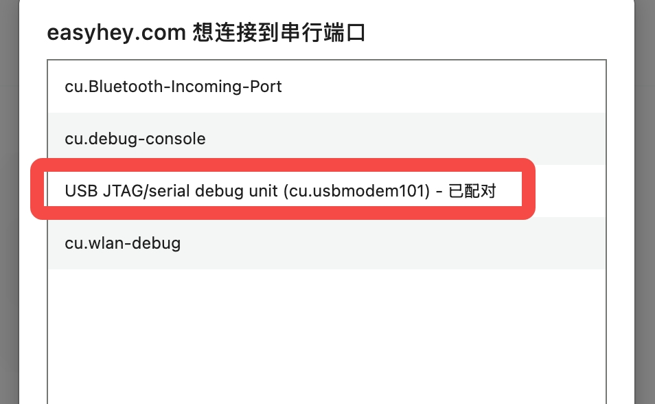

# BikePower C 快速上手

这份文档面向第一次接触 BikePower C 的普通用户。你不需要先理解代码或电路，只要跟着下面的步骤做，就能把设备接通、配对并开始使用。

## 1. 硬件清单

- 一块 ESP32-C3 开发板
- 一根可正常传输数据的 USB 线（部分充电线无法传输数据，请确认你的线支持数据传输）
- 一个稳定电源（电脑 USB 口或 5V 充电器均可）

如果你只是体验基础功能，上面三样就够了。想进一步做固定安装、外壳封装或外接传感器，可以再参考 [硬件指南](03-hardware.md)。

## 2. 烧录固件

> 如果你的开发板已经预装了 BikePower 固件，可以跳过此步骤，直接进入第 3 节。

普通用户统一使用网页端在线烧录，不需要下载固件文件，也不需要安装 esptool、ESP-IDF 或乐鑫 Flash Download Tool。

BikePower C 已永久放弃设备内 OTA 升级。后续升级、重刷或恢复固件，都按本节电脑端网页烧录流程操作。

1. 使用桌面版 Chrome 或 Edge 打开 [BikePower BLE Monitor / 固件刷写页](https://mengen-ink.github.io/bikepower-c/)；Pages 首次部署尚未完成或临时不可用时，可使用[备用烧录入口](https://easyhey.com/?firmware=MOD220)。
2. 用支持数据传输的 USB 线把开发板连接到电脑。
3. 在“固件刷写”区域选择 `通用 ESP32-C3` 或 `M5Stamp C3`，核对最新版本、文件名和 SHA256。
4. 点击“连接串口并刷写”，浏览器会弹出串口选择窗口。
5. 选择名称类似 `USB JTAG/serial debug unit` 的端口；macOS 上通常会显示为 `USB JTAG/serial debug unit (cu.usbmodem101)`，Windows 上通常显示为 `COMx`。
6. 按网页提示确认并等待烧录完成。
7. 烧录完成后重新上电或按一下开发板的 RST 复位键，设备启动。

网页刷写依赖 HTTPS 和 Web Serial，浏览器必须由用户点击按钮并主动选择串口，网页不能静默选择设备。如果列表里看不到开发板，先确认 USB 线不是纯充电线，再重新插拔开发板并刷新网页。少数开发板需要按住 BOOT 键再点击连接或开始烧录，进度开始后即可松开。

开发者仍可使用仓库脚本或 ESP-IDF 从源码编译烧录；这些方式只面向开发和测试，不作为普通用户手册路径。

## 3. 第一次使用步骤

1. 给设备接电，等待设备启动
2. 打开手机或平板上的骑行 App，进入添加蓝牙设备页面
3. 在 BLE 设备列表里搜索 `BikePower`
4. 选择设备并完成配对或连接
5. 连接成功后，开始调功和骑行训练

如果 LED 处于慢闪，通常表示设备已经开机并正在等待蓝牙连接；连接成功后一般会变成常亮。

## 4. 配网快速指引

当你想改默认参数（功率、踏频、心率、设备名称等），进入设备自己的 WiFi 配网页面：

1. 长按按钮至少 `2` 秒后松开
2. 看到 LED 进入确认提示后，再按一次按钮
3. 手机连接 WiFi 热点 `BikePower-XXXXXX`（后 6 位因设备而异），密码 `12345678`
4. 打开浏览器，访问 `192.168.4.1`，按页面提示修改并保存

配网是临时状态，不是开机默认状态；当前固件 WiFi/BLE 共存，普通配网不会断开 BLE，也不重启。字段说明、保存流程、模式选择等完整内容见 [用户手册](02-user-manual.md)。

## 5. 下一步

- 完整按钮操作、LED 灯效、配网字段、骑行模式与 FAQ：见 [用户手册](02-user-manual.md)
- 固件升级：当前 v4.1.1 已永久放弃设备内 OTA，普通用户升级统一走仓库 GitHub Pages；Pages 尚未上线时使用[备用烧录入口](https://easyhey.com/?firmware=MOD220)
- 硬件接线、供电与排障：见 [硬件指南](03-hardware.md)
