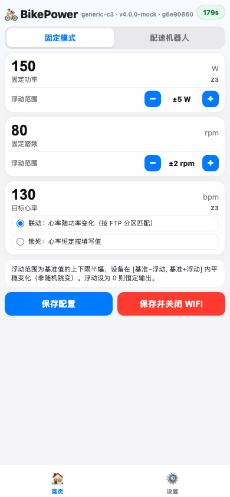
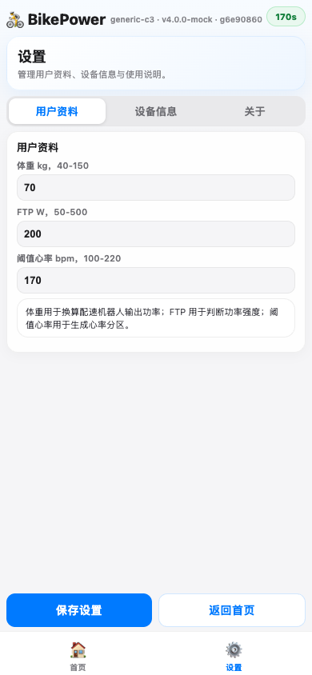
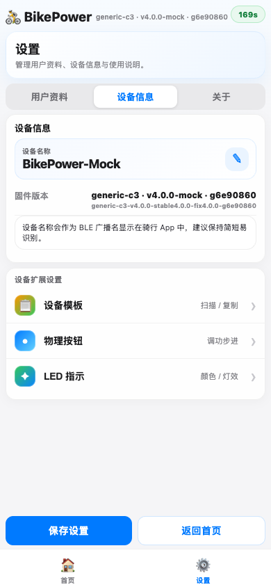
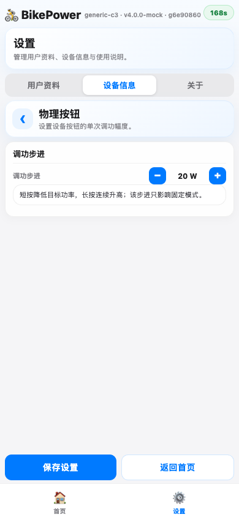
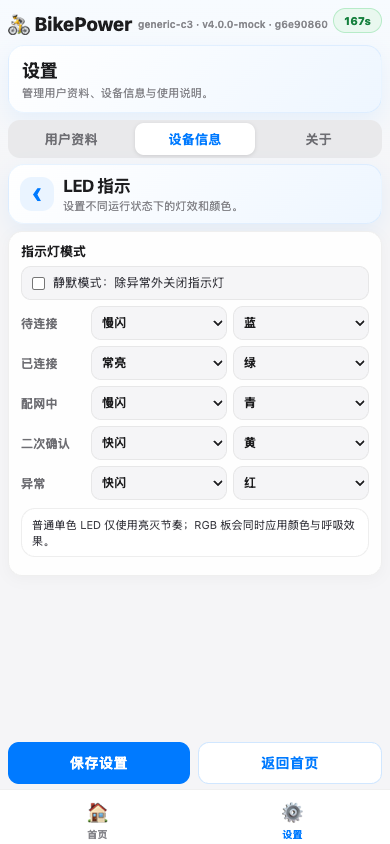
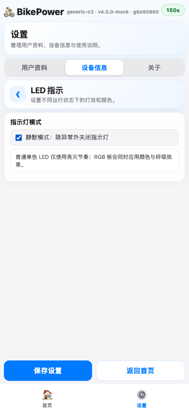
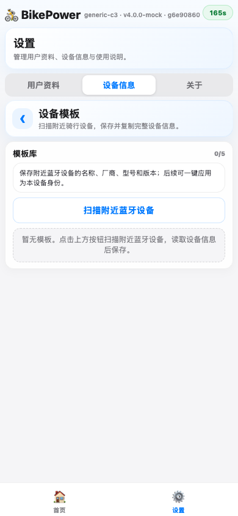

# BikePower C 用户手册

本手册按“日常怎么用”编写，重点说明连接、按钮、配网页和保存步骤。

默认蓝牙名称为 `BikePower`。默认 WiFi 热点名称为 `BikePower-XXXXXX`，后 6 位每台设备不同。当前固件版本为 `v4.0.1`。

## 1. 上电后连接骑行 App

1. 用 USB 或稳定 5V 电源给设备上电。
2. 等待设备启动，LED 通常进入慢闪。
3. 打开骑行 App，进入添加设备或蓝牙设备搜索页面。
4. 搜索并连接 `BikePower`。
5. 连接成功后，App 会收到功率、踏频、心率和训练机数据。

如果 App 支持多种设备类型，优先按功率计、心率计、踏频传感器或智能训练台搜索。

## 2. 按钮日常操作

设备上的按钮用于快速调功和进入配网。

| 操作 | 效果 | 适用场景 |
|------|------|------|
| 短按一次 | 功率减少一个步进 | 骑行中临时降低强度 |
| 按住约 `0.5s` 后继续按住 | 持续增加功率 | 骑行中快速升强度 |
| 长按超过 `2s` 后松开 | 进入配网确认窗口 | 准备修改网页设置 |
| 确认窗口内再按一次 | 打开 WiFi 配网页 | 修改功率、设备名、LED 等配置 |
| 确认窗口内不再操作 | 自动取消 | 防误触 |

按钮调功步进默认 `20W`，可在网页“设置 → 设备信息 → 物理按钮”里修改。

## 3. 进入 WiFi 配网页

BikePower C 不会开机自动打开 WiFi。只有手动长按并二次确认后，才会进入配网。

1. 长按按钮至少 `2s` 后松开。
2. 看到 LED 进入快闪确认状态。
3. 在确认窗口内再按一次按钮。
4. 手机连接热点 `BikePower-XXXXXX`，密码 `12345678`。
5. 浏览器访问 `http://192.168.4.1`。
6. 修改配置后点击“保存配置”或“保存设置”。
7. 不再修改时点击“保存并关闭 WiFi”，等待约 `5s` 后热点关闭。

手机提示“此网络无互联网”是正常现象，继续保持连接即可。配网期间 BLE 会保持工作，骑行 App 通常可以继续接收数据。

## 4. 首页：调功率、踏频、心率和模式

首页用于骑行中最常改的参数。

1. 选择顶部模式：
   - “固定模式”：手动设置功率、踏频、心率。
   - “配速机器人”：按体重和 W/kg 区间自动换算功率。
2. 固定模式下，直接修改“固定功率”“固定踏频”“目标心率”。
3. 用每张卡片下方的 `- / +` 调整浮动范围。浮动越大，App 看到的数值变化越明显。
4. 如需固定心率，打开“锁定心率”；关闭后心率会跟随功率算法变化。
5. 配速机器人模式下，选择机器人档位；选择“自定义”后可改昵称和 W/kg 上下限。
6. 点击“保存配置”，让当前首页参数立即保存并生效。
7. 修改完成后，点击“保存并关闭 WiFi”退出配网。

模式建议：

- 想明确固定在某个瓦数附近：用“固定模式”。
- 想按体重模拟跟骑强度：用“配速机器人”。
- 使用训练 App 的 ERG 课程：让 App 下发目标功率，手动功率可能暂不生效。

## 5. 设置：用户资料

用户资料会影响功率区间、心率区间和配速机器人计算。

1. 点击底部“设置”。
2. 进入“用户资料”页。
3. 填写体重、FTP、阈值心率。
4. 点击底部“保存设置”。

字段建议：

| 字段 | 范围 | 说明 |
|------|------|------|
| 体重 | `40-150kg` | 配速机器人按体重换算功率 |
| FTP | `50-500W` | 用于功率区间显示 |
| 阈值心率 | `100-220BPM` | 用于心率区间显示 |

## 6. 设置：设备信息

设备信息页用于修改蓝牙名称、查看固件版本，并进入扩展设置。

修改蓝牙名称：

1. 进入“设置 → 设备信息”。
2. 在设备名称卡片右侧点击编辑按钮。
3. 输入新的设备名称。
4. 点击对勾确认。
5. 点击底部“保存设置”。

注意：只输入名称但不点对勾，不会进入保存流程。名称建议简短，便于骑行 App 搜索识别。

扩展设置入口：

- “设备模板”：扫描附近 BLE 设备，复制设备信息。
- “物理按钮”：调整按钮调功步进。
- “LED 指示”：设置灯效、颜色或静默模式。

## 7. 设置：物理按钮

物理按钮页用于修改每次短按或长按调功的步进。

1. 进入“设置 → 设备信息 → 物理按钮”。
2. 点击 `- / +` 调整步进。
3. 推荐日常使用 `10W`、`15W` 或 `20W`。
4. 点击底部“保存设置”。

可选范围为 `5-50W`。步进越大，按钮调功越快；步进越小，调整越细。

## 8. 设置：LED 指示

LED 指示页用于给不同运行状态设置灯效和颜色。

1. 进入“设置 → 设备信息 → LED 指示”。
2. 按状态选择灯效和颜色。
3. 点击底部“保存设置”。

可设置的状态：

| 状态 | 含义 |
|------|------|
| 待连接 | 设备正在 BLE 广播，等待 App 连接 |
| 已连接 | App 已连接设备 |
| 配网中 | WiFi 热点已打开，可访问网页 |
| 二次确认 | 长按后等待再次按键确认 |
| 异常 | 设备检测到异常状态 |

灯效可选关闭、常亮、慢闪、快闪、双闪、呼吸。普通单色 LED 只体现亮灭节奏，M5Stamp C3 等 RGB 板会同时体现颜色。

### 静默模式

打开“静默模式：除异常外关闭指示灯”后，下方各状态的灯效和颜色选择会自动隐藏，避免用户误以为还能编辑普通灯效。

使用建议：

1. 夜骑、卧室或不想被灯光打扰时，打开静默模式。
2. 需要重新设置颜色和闪烁方式时，先关闭静默模式。
3. 修改后点击“保存设置”。

## 9. 设置：设备模板

设备模板用于从附近 BLE 设备读取基础信息，并复制到本设备，方便让 BikePower 在 App 中显示更容易识别的名称和设备信息。

1. 进入“设置 → 设备信息 → 设备模板”。
2. 点击“扫描附近蓝牙设备”。
3. 在扫描结果中选择目标设备，点击读取信息。
4. 确认模板别名后保存模板。
5. 需要使用时，点击“复制到本设备”。
6. 返回设备信息页，确认名称变化后点击“保存设置”。

模板库最多保存 5 个。扫描只展示带名称且包含骑行相关服务的设备。

## 10. 保存和退出配网

网页里有两个常用保存按钮：

| 按钮 | 作用 |
|------|------|
| “保存配置” / “保存设置” | 保存当前页面配置，WiFi 继续保持打开 |
| “保存并关闭 WiFi” | 保存首页配置，并在约 `5s` 后关闭热点 |

推荐流程：

1. 先在首页和设置页完成所有修改。
2. 每个页面改完后点击对应的保存按钮。
3. 最后回到首页，点击“保存并关闭 WiFi”。
4. 手机会断开 `BikePower-XXXXXX` 热点，设备回到日常 BLE 使用状态。

如果只关闭浏览器或直接断电，最后一次未保存的修改可能不会保留。

## 11. 常见问题

### 搜不到 BLE 设备

先确认设备已上电且 LED 有状态变化。然后在骑行 App 里重新扫描 `BikePower`。如果仍搜不到，重启 App 或重新给设备上电。

### 进不了 WiFi 配网页

确认已经完成两步按钮操作：长按超过 `2s`，松开后再按一次确认。然后连接 `BikePower-XXXXXX` 热点，手动访问 `192.168.4.1`。

### 手机提示无互联网

这是正常现象。BikePower 的 WiFi 只用于本地配置，不提供外网。

### 保存后 App 没变化

先确认点的是“保存配置”或“保存设置”。如果改的是蓝牙名称，部分 App 需要断开后重新扫描才能看到新名称。

### 功率变化不符合预期

先看当前模式。固定模式按手动设置输出；配速机器人按体重和 W/kg 算功率；ERG 模式可能由训练 App 接管目标功率。

### LED 选项不见了

检查是否打开了静默模式。静默模式开启后，普通状态的灯效和颜色选择会隐藏；关闭静默模式后可继续编辑。

## 12. 记住这 4 步

1. 上电后先连接骑行 App 的蓝牙设备。
2. 需要改配置时，长按按钮并二次确认进入 WiFi。
3. 在网页里修改参数后点击保存。
4. 改完点击“保存并关闭 WiFi”，回到日常骑行使用。
