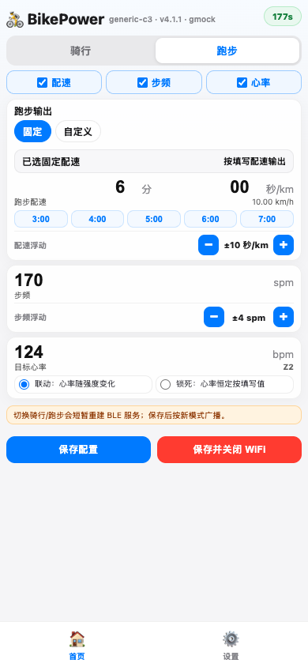

# BikePower C 使用说明

本说明面向日常使用者，按“烧录固件 → 连接 App → 进入配网 → 修改参数 → 保存退出”的顺序操作。当前固件版本为 `v4.1.1`。

## 1. 烧录或更新固件

普通用户使用电脑浏览器在线烧录，不需要安装 ESP-IDF 或命令行工具。

1. 用 Chrome 或 Edge 打开 `https://easyhey.com/?firmware=MOD220`。
2. 用支持数据传输的 USB 线连接 ESP32-C3 开发板。
3. 点击网页里的连接或烧录按钮。
4. 在弹出的串口列表中选择开发板端口。
5. 等待烧录完成后，重新上电或按 RST 复位键。

注意事项：

- 串口常见名称：macOS 为 `USB JTAG/serial debug unit` 或 `cu.usbmodem*`，Windows 为 `COMx`。
- 如果看不到设备，优先更换一根支持数据传输的 USB 线。
- 少数开发板需要按住 BOOT 键再点击连接或开始烧录，进度开始后即可松开。
- BikePower C 不使用设备内 OTA；升级、重刷和恢复固件都走网页端在线烧录。

## 2. 连接骑行或跑步 App

1. 给设备接电，等待启动完成。
2. 打开骑行或跑步 App 的蓝牙设备搜索页面。
3. 搜索并连接 `BikePower`。
4. 连接成功后，App 会收到功率、踏频、心率、训练机或跑步数据。

注意事项：

- 骑行 App 中优先按功率计、心率计、踏频传感器或智能训练台搜索。
- 跑步 App 中优先按跑步传感器或跑步机入口搜索。
- 如果改过蓝牙名称，App 里显示的是新名称；必要时断开后重新扫描。

## 3. 进入配网页

BikePower 不会开机自动打开 WiFi，只有手动确认后才进入配网。

1. 长按设备按钮至少 `2s` 后松开。
2. 看到 LED 进入快闪确认状态后，再按一次按钮。
3. 手机连接热点 `BikePower-XXXXXX`，密码 `12345678`。
4. 浏览器访问 `http://192.168.4.1`。

注意事项：

- 手机提示“此网络无互联网”是正常现象，保持连接即可。
- 配网页有倒计时，时间不足时点击“续期配网”。
- 当前固件配网期间 BLE 保持在线；只有切换骑行/跑步模式后，保存时才需要 App 断开并重新连接以刷新 BLE 服务。

## 4. 设置骑行输出

骑行模式用于给 Zwift、MyWhoosh 等 App 广播功率、踏频和心率。

1. 首页顶部选择“骑行”。
2. 勾选需要广播的数据项：功率、踏频、心率。
3. 选择“固定”或配速机器人。
4. 固定模式下填写功率、踏频和目标心率。
5. 通过 `- / +` 调整浮动范围。
6. 点击“保存配置”。

注意事项：

- 浮动范围为上下半幅，设为 `0` 时表示恒定输出。
- 如果训练 App 正在通过 ERG 下发目标功率，手动功率可能暂不生效。
- 参数改完后必须点击保存；只修改输入框不会自动持久化。

## 5. 设置跑步输出

跑步模式用于广播跑步速度、步频和心率。

1. 首页顶部选择“跑步”。
2. 选择固定配速或自定义模板。
3. 固定配速可直接点 `3:00` 到 `7:00` 的常用按钮。
4. 设置步频、步频浮动和目标心率。
5. 点击“保存配置”。

注意事项：

- 跑步心率可选择“联动”或“锁死”。
- 切换骑行/跑步后，保存会触发 BLE 服务重建；让 App 断开后重新连接即可看到新模式。

## 6. 修改用户资料

用户资料会影响功率区间、心率区间和配速机器人计算。

1. 点击底部“设置”。
2. 进入“用户资料”。
3. 填写体重、FTP、阈值心率。
4. 点击“保存设置”。

建议范围：

| 字段 | 范围 | 用途 |
|------|------|------|
| 体重 | `40-150kg` | 配速机器人按体重换算功率 |
| FTP | `50-500W` | 判断功率强度 |
| 阈值心率 | `100-220BPM` | 生成心率分区 |

## 7. 修改设备设置

配置设备页用于修改蓝牙名称，并进入设备模板、物理按钮、LED 指示等扩展设置。

1. 点击“设置 → 配置设备”。
2. 点击设备名称右侧编辑按钮。
3. 输入新的蓝牙名称。
4. 点击对勾确认。
5. 点击“保存设置”。

注意事项：

- 名称建议简短，便于 App 搜索识别。
- 只输入名称但不点击对勾，不会进入保存流程。
- 进入“物理按钮”可修改短按或长按调功步进。

## 8. 保存并退出配网

网页里有两个保存入口：

| 按钮 | 作用 |
|------|------|
| 保存配置 / 保存设置 | 保存当前页面配置，WiFi 继续保持打开 |
| 保存并关闭 WiFi | 保存首页配置，并在约 `5s` 后关闭热点 |

推荐收尾步骤：

1. 每个页面改完后先点击对应的保存按钮。
2. 最后回到首页，点击“保存并关闭 WiFi”。
3. 等待热点断开。
4. 回到骑行或跑步 App，确认数据继续刷新。

## 9. 常见问题

| 问题 | 处理方式 |
|------|----------|
| App 搜不到设备 | 确认设备已上电，重启 App 后重新扫描 `BikePower` |
| 进不了配网页 | 确认已完成“长按 2s + 再按一次”的二次确认 |
| 手机提示无互联网 | 正常现象，BikePower 热点只用于本地配置 |
| 保存后 App 没变化 | 确认已点击保存；改蓝牙名称或运动模式后重新连接 App |
| LED 选项消失 | 检查是否打开了静默模式 |

记住日常使用的 4 步：上电连接 App，长按按钮进入配网，网页修改后保存，最后关闭 WiFi 回到训练。
